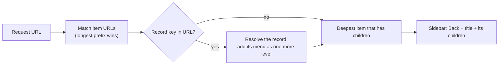
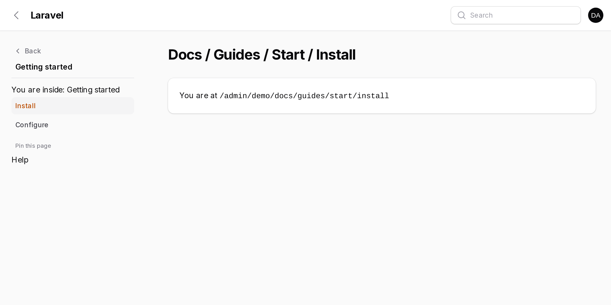
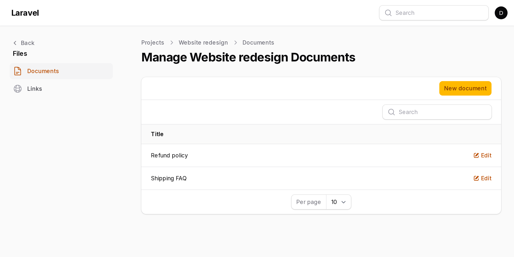
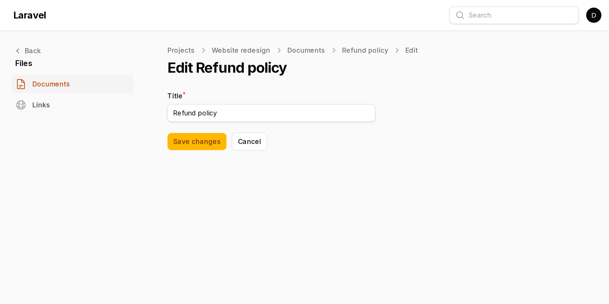

# Filament Drilldown Nav

Drill-down sidebar navigation for **Filament v5**: one left sidebar, **one level at a time**, a **Back** link, any depth — and a **menu per record** (click an project, get that project's own menu).


## Why

Filament's sidebar nests everything in place, and a cluster's or page's sub-navigation appears as a *second* menu beside the content. That is fine for two levels. It gets awkward when a record has its own area with its own sub menus (3–4 levels) and you want it all in **one** place.

| You want | Filament alone | This plugin |
|---|---|---|
| A menu for one record (project, site, customer …) | build a sub-navigation per page | `->record(fn ($record) => [...])` |
| 3–4 levels in the left sidebar | groups + one parent level | any depth |
| One menu location | sidebar **and** sub-navigation | the sidebar |
| Keep `$navigationGroup`, `$navigationParentItem`, badges, `canAccess()` | — | `NavItem::fromFilamentNavigation()` |

> If two levels are enough for you, Filament's native groups, parent items and Clusters are simpler. Use this plugin when you need more depth or a menu per record.

## How it works (short)

The level you see is computed **on the server from the URL, on every request**: no JavaScript state, so refreshes and shared links land in the right place.



Full explanation with more diagrams (level selection, per-record sequence, native navigation reuse, class overview): **[docs/how-it-works.md](docs/how-it-works.md)**.

## Requirements

PHP 8.3+, Laravel 13, Filament v5.

## Install

Not on Packagist yet:

```bash
composer config repositories.drilldown vcs https://github.com/solutionforest/filament-drilldown-nav
composer require solutionforest/filament-drilldown-nav:dev-main
```

## Quick start

```php
use SolutionForest\DrilldownNav\DrilldownNavPlugin;
use SolutionForest\DrilldownNav\Tree\NavItem;

$panel->plugin(DrilldownNavPlugin::make()->items(fn () => [
    NavItem::page(Dashboard::class),                       // label, icon, URL, access from the class

    NavItem::resource(ProjectResource::class)                // list = a normal Filament table
        ->record(fn (Project $project) => [                    // menu shown INSIDE one project
            NavItem::make('Overview')->icon('heroicon-o-eye')
                ->url(ProjectResource::getUrl('view', ['record' => $project])),
            NavItem::make('Tasks')->icon('heroicon-o-clipboard-document-check')
                ->url(ProjectResource::getUrl('section', ['record' => $project, 'section' => 'tasks'])),
            NavItem::make('Files')->icon('heroicon-o-book-open')->children([   // a sub menu
                NavItem::resource(DocumentResource::class, ['project' => $project]),   // nested resource
                NavItem::make('Links')->url(ProjectResource::getUrl('section', ['record' => $project, 'section' => 'links'])),
            ]),
        ]),

    ...NavItem::fromFilamentNavigation(),                  // everything else Filament would show
]));
```

The plugin empties Filament's own list (keeping the sidebar shell, topbar and mobile drawer): **only items returned from `items()` are shown.**

## Tutorial

### 1. Pages, resources and plain URLs

```php
NavItem::page(Dashboard::class);                 // Filament Page
NavItem::resource(SiteResource::class);          // Filament Resource (list URL)
NavItem::make('Reports')->icon('heroicon-o-chart-bar')->url('/admin/reports')->badge('3', 'danger'); // any URL, e.g. a React page
```

### 2. Nested levels

```php
NavItem::make('Docs')->url('/admin/docs')->children([
    NavItem::make('Guides')->url('/admin/docs/guides')->children([
        NavItem::make('Install')->url('/admin/docs/guides/install'),
    ]),
]);
```

An item with children opens its own level when you visit its URL. An item **without a URL** is a pure group: clicking it goes to its first child.

| Level 4 | Reports (native group, badge) |
|---|---|
|  |  |

### 3. A menu per record

`record()` is the feature this plugin exists for. When the URL is `<list URL>/<key>/…` (and the key is not `create`), the key is resolved with the resource's own route binding and the sidebar shows your menu, titled with the record's title. Back returns to the list.

```php
NavItem::resource(ProjectResource::class)->record(fn (Project $project) => [ /* any NavItems, any depth */ ]);
```

| One project's menu | Sub menu inside it |
|---|---|
|  |  |

Record-menu URLs must live under the resource's own URL (`/admin/projects/{record}/…`), because that is how the plugin knows you are inside the record. Register extra pages on the resource, **after** `edit`:

```php
'edit' => EditProject::route('/{record}/edit'),
'section' => ProjectSection::route('/{record}/{section}'),
```

For a non-resource item use `->resolveRecordUsing(fn (string $key) => …)` and `->recordTitleUsing(fn ($record) => …)`. Fixed pages below the list URL (like `/projects/import`) are never mistaken for a record: they are excluded automatically for `resource()`, or with `->ignoreRecordKeys(['create', 'import'])`.

### 4. Reuse Filament's own navigation

Anything you already declare the Filament way keeps working (`$navigationGroup`, `$navigationParentItem`, `$navigationSort`, `$navigationBadge`, `shouldRegisterNavigation()`, `canAccess()`, `NavigationItem::make()`):

```php
...NavItem::fromFilamentNavigation(
    fn (NavigationItem $item): bool => $item->getUrl() !== Dashboard::getUrl() // leave out what you list by hand
)
```

Groups become URL-less groups (with the group icon you registered on the panel), parent items become sub levels, badges and access checks carry over. See the *Reports* group in the demo.

### 5. Visibility and badges

```php
NavItem::make('Billing')->visible(fn () => auth()->user()->isAdmin());
NavItem::make('Inbox')->badge(fn () => (string) Message::unread()->count(), 'danger');
```

Empty groups disappear. Closures run once per request, and only for items on the current path.

## Demo app

`demo/` is a Laravel 13 + Filament v5 app wired to the package via a path repository. It is deliberately more than a toy:

| Area | What it shows |
|---|---|
| **Projects** (Resource) | a table; click a row → that project's own menu (Overview, Tasks, Files, Settings) |
| Files → Documents | a **nested resource** scoped to the project (own table, create, edit) |
| Settings | a group with sub menus inside a record menu |
| **Reports** | a group imported from **native Filament navigation**: sort order, group icon, badge, a native *parent item* (Usage → By project) and a permission-gated page (Billing) |
| **Docs** | a static 4-level tree (custom pages / React pages are just URLs) |
| **Settings** | a pure group (no URL of its own) |

```bash
cd demo
composer install
cp .env.example .env && php artisan key:generate
touch database/database.sqlite && php artisan migrate --seed
php artisan serve
```

Log in at `/admin/login` with `demo@example.com` / `password` (local demo data only).

<details>
<summary>More screenshots</summary>

| Projects table | Nested resource inside an project |
|---|---|
|  |  |

| Native parent item (Usage → By project) | Dark mode |
|---|---|
|  |  |

| Mobile drawer |
|---|
|  |

</details>

## Quality

```bash
composer check                  # Pint + PHPStan (level 9, no baseline) + Pest
cd demo && php artisan test     # feature tests: real pages rendered through the panel
```

- **Pest** (package): URL matching, level selection, groups, per-record menus, nested sub menus, once-per-request evaluation, ignored keys, failing lookups.
- **Demo feature tests**: each level, record menus, nested resources, native navigation import, badges, permissions, no duplicates.
- **PHPStan level 9** on `src/`, with no ignores.
- CI (`.github/workflows/tests.yml`) runs everything on a **self-hosted** runner; fork pull requests are skipped.

## Documentation

- [How it works](docs/how-it-works.md) — problem, request flow, record menus, native navigation, class overview.
- [AGENTS.md](AGENTS.md) — for people and AI agents changing this repo.
- [SKILLS.md](SKILLS.md) — for AI agents adding the plugin to a Filament app.

## Limits

Collapsed (icon-only) sidebar mode is not specially handled yet. The plugin owns the sidebar list, so items you do not list (or import) are not shown.

## License

MIT
