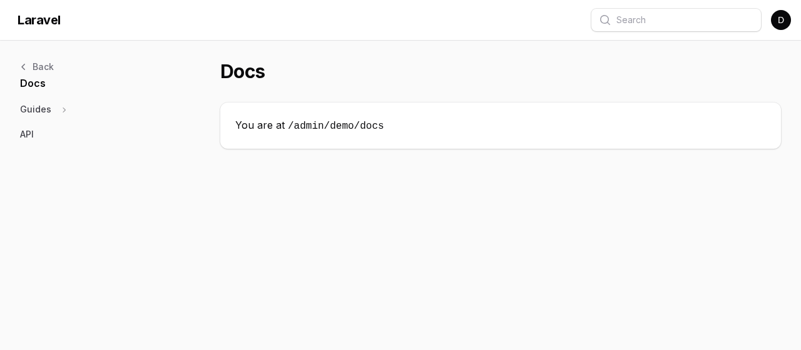
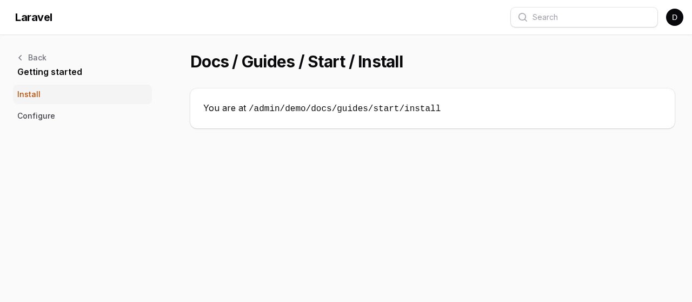
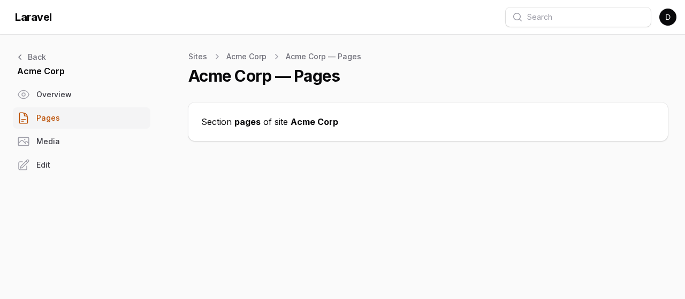

# Filament Drilldown Nav

Drill-down (slide) multi-level sidebar navigation for **Filament v5**.

One left sidebar shows **one level at a time**. Clicking an item that has children replaces the list with that item's own menu, with a **Back** link and the section title. Works at any depth, and **inside a single record** (e.g. one Site) the sidebar shows that record's own menu.

> **Status: early.** Tested in the demo app (levels, records, groups). Not yet done: collapsed (icon-only) sidebar behaviour, and visual checks of dark mode, the mobile drawer and SPA mode.

| Top level | Level 2 |
|---|---|
|  |  |
| **Level 4** | **Inside one record (Site → its own menu)** |
|  |  |

## Requirements

PHP 8.3+, Laravel 13, Filament v5.

## Install

Not on Packagist yet. Add the repository to your app's `composer.json`, then require it:

```bash
composer config repositories.drilldown vcs https://github.com/solutionforest/filament-drilldown-nav
composer require solutionforest/filament-drilldown-nav:dev-main
```

## Tutorial

### 1. Register the plugin on your panel

```php
use SolutionForest\DrilldownNav\DrilldownNavPlugin;
use SolutionForest\DrilldownNav\Tree\NavItem;

$panel->plugin(DrilldownNavPlugin::make()->items(fn () => [
    NavItem::page(Dashboard::class),                 // label, icon, URL, access from the page class
    NavItem::resource(SiteResource::class),          // label, icon, index URL, access from the resource
    NavItem::make('Reports')->icon('heroicon-o-chart-bar')->url('/admin/reports'), // any URL, e.g. a React page
]));
```

The plugin empties Filament's native navigation (keeping the sidebar shell, topbar and mobile drawer) and renders the drill-down menu instead. **Items you don't list are not shown**, so list every Resource/Page you want in the menu.

### 2. Nested levels

```php
NavItem::make('Docs')->url('/admin/docs')->children([
    NavItem::make('Guides')->url('/admin/docs/guides')->children([
        NavItem::make('Install')->url('/admin/docs/guides/install'),
    ]),
]);
```

An item with children opens its own level when you visit its URL. An item **without a URL** is a pure group: clicking it goes to its first child, and Back from a level under it returns to that group's level.

### 3. A menu per record ("click a Site, get that Site's menu")

```php
NavItem::resource(SiteResource::class)->record(fn (Site $site) => [
    NavItem::make('Overview')->url(SiteResource::getUrl('view', ['record' => $site])),
    NavItem::make('Pages')->url(PageResource::getUrl('index', ['site' => $site])),
    NavItem::make('Media')->url(...),
]);
```

When the URL is `<resource index>/<key>/…` (not `create`), the key is resolved to a record with the resource's own route binding and the sidebar shows the closure's menu, titled with the record's title (`getRecordTitle`). Back returns to the resource list. For a non-resource item, use `->resolveRecordUsing(fn (string $key) => …)` and `->recordTitleUsing(fn ($record) => …)`.

> Record menu URLs should live under the resource's own URL (`/admin/sites/{record}/…`), because that is how the plugin knows you are inside the record. A resource page registered as `'section' => SiteSection::route('/{record}/{section}')` (see the demo) does this.

### How the current level is chosen

On every request the plugin matches the request path against item URLs (path part only; **longest prefix wins**; the panel root URL matches exactly only) and renders the children of the deepest matching item that has children. Unknown URLs show the top level with nothing highlighted. This is resolved on the server, so deep links and refreshes land on the right level. `children()`/`->record()` closures run at most once per request, and only for items on the current path.

## Demo app

`demo/` is a Laravel 13 + Filament v5 app wired to the package via a path repository (a `Site` resource with per-record menu, a 4-level Docs tree, and a pure group).

```bash
cd demo
composer install
cp .env.example .env && php artisan key:generate
touch database/database.sqlite && php artisan migrate --seed
php artisan serve
```

Log in at `/admin/login` with `demo@example.com` / `password` (local demo data only).

## Tests & CI

```bash
vendor/bin/pest                 # package: path resolution, levels, groups, record menus
vendor/bin/pint --test          # code style
cd demo && php artisan test     # demo: renders each level through the real panel
```

GitHub Actions (`.github/workflows/tests.yml`) runs all of the above on a **self-hosted** runner (needs PHP 8.3+ and Composer). Fork pull requests are skipped so untrusted code never runs on the runner.

## License

MIT
