# Filament Drilldown Nav

Drill-down sidebar navigation for **Filament v5**: one left sidebar, **one level at a time**, a **Back** link, any depth — and a **menu per record** (click an project, get that project's own menu).

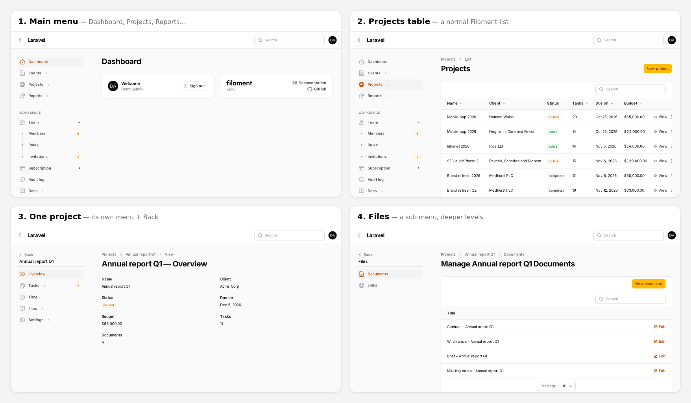

## Why

Filament's sidebar nests everything in place, and a cluster's or page's sub-navigation appears as a *second* menu beside the content. That is fine for two levels. It gets awkward when a record has its own area with its own sub menus (3–4 levels) and you want it all in **one** place.

| You want | Filament alone | This plugin |
|---|---|---|
| A menu for one record (project, site, customer …) | build a sub-navigation per page | `->record(fn ($record) => [...])` |
| 3–4 levels in the left sidebar | groups + one parent level | any depth |
| One menu location | sidebar **and** sub-navigation | the sidebar |
| Keep `$navigationGroup`, `$navigationParentItem`, badges, `canAccess()` | — | `NavItem::fromFilamentNavigation()` |

> If two levels are enough for you, Filament's native groups, parent items and Clusters are simpler. Use this plugin when you need more depth or a menu per record.

## How it works (short)

The level you see is computed **on the server from the URL, on every request**: no JavaScript state, so refreshes and shared links land in the right place.

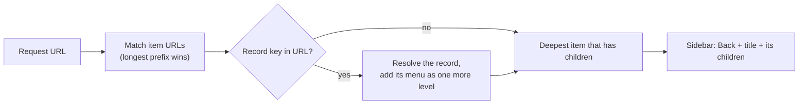

Full explanation with more diagrams (level selection, per-record sequence, native navigation reuse, class overview): **[docs/how-it-works.md](docs/how-it-works.md)**.

## Requirements

PHP 8.3+, Laravel 13, Filament v5.

## Install

Not on Packagist yet:

```bash
composer config repositories.drilldown vcs https://github.com/solutionforest/filament-drilldown-nav
composer require solutionforest/filament-drilldown-nav:dev-main
```

## Quick start

```php
use SolutionForest\DrilldownNav\DrilldownNavPlugin;
use SolutionForest\DrilldownNav\Tree\NavItem;

$panel->plugin(DrilldownNavPlugin::make()->items(fn () => [
    NavItem::page(Dashboard::class),                       // label, icon, URL, access from the class

    NavItem::resource(ProjectResource::class)                // list = a normal Filament table
        ->record(fn (Project $project) => [                    // menu shown INSIDE one project
            NavItem::make('Overview')->icon('heroicon-o-eye')
                ->url(ProjectResource::getUrl('view', ['record' => $project])),
            NavItem::make('Tasks')->icon('heroicon-o-clipboard-document-check')
                ->url(ProjectResource::getUrl('section', ['record' => $project, 'section' => 'tasks'])),
            NavItem::make('Files')->icon('heroicon-o-book-open')->children([   // a sub menu
                NavItem::resource(DocumentResource::class, ['project' => $project]),   // nested resource
                NavItem::make('Links')->url(ProjectResource::getUrl('section', ['record' => $project, 'section' => 'links'])),
            ]),
        ]),

    ...NavItem::fromFilamentNavigation(),                  // everything else Filament would show
]));
```

The plugin empties Filament's own list (keeping the sidebar shell, topbar and mobile drawer): **only items returned from `items()` are shown.**

## Tutorial

### 1. Pages, resources and plain URLs

```php
NavItem::page(Dashboard::class);                 // Filament Page
NavItem::resource(SiteResource::class);          // Filament Resource (list URL)
NavItem::make('Reports')->icon('heroicon-o-chart-bar')->url('/admin/reports')->badge('3', 'danger'); // any URL, e.g. a React page
```

### 2. Nested levels

```php
NavItem::make('Docs')->url('/admin/docs')->children([
    NavItem::make('Guides')->url('/admin/docs/guides')->children([
        NavItem::make('Install')->url('/admin/docs/guides/install'),
    ]),
]);
```

An item with children opens its own level when you visit its URL. An item **without a URL** is a pure group: clicking it goes to its first child.

| Level 4 | Reports (native group, badge) |
|---|---|
|  |  |

### 3. A menu per record

`record()` is the feature this plugin exists for. When the URL is `<list URL>/<key>/…` (and the key is not `create`), the key is resolved with the resource's own route binding and the sidebar shows your menu, titled with the record's title. Back returns to the list.

```php
NavItem::resource(ProjectResource::class)->record(fn (Project $project) => [ /* any NavItems, any depth */ ]);
```

| One project's menu | Sub menu inside it |
|---|---|
| 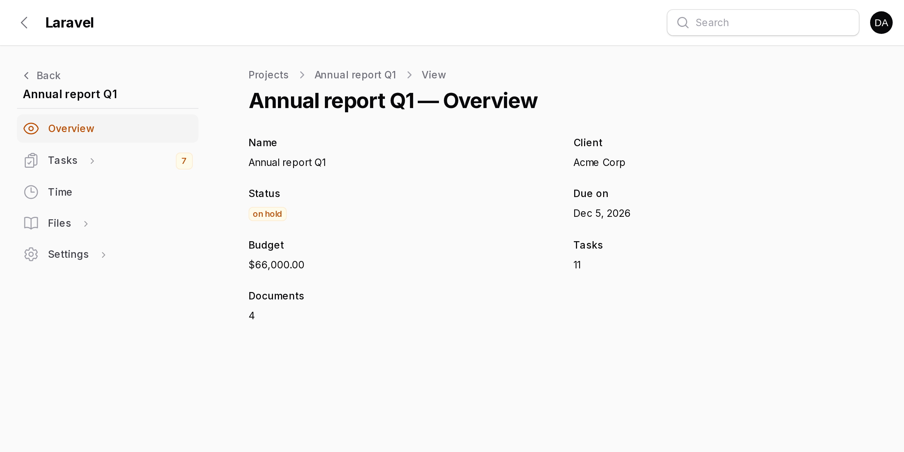 |  |

Record-menu URLs must live under the resource's own URL (`/admin/projects/{record}/…`), because that is how the plugin knows you are inside the record. Register extra pages on the resource, **after** `edit`:

```php
'edit' => EditProject::route('/{record}/edit'),
'section' => ProjectSection::route('/{record}/{section}'),
```

For a non-resource item use `->resolveRecordUsing(fn (string $key) => …)` and `->recordTitleUsing(fn ($record) => …)`. Fixed pages below the list URL (like `/projects/import`) are never mistaken for a record: they are excluded automatically for `resource()`, or with `->ignoreRecordKeys(['create', 'import'])`.

### 4. Reuse Filament's own navigation

Anything you already declare the Filament way keeps working (`$navigationGroup`, `$navigationParentItem`, `$navigationSort`, `$navigationBadge`, `shouldRegisterNavigation()`, `canAccess()`, `NavigationItem::make()`):

```php
...NavItem::fromFilamentNavigation(
    fn (NavigationItem $item): bool => $item->getUrl() !== Dashboard::getUrl() // leave out what you list by hand
)
```

Groups become URL-less groups (with the group icon you registered on the panel), parent items become sub levels, badges and access checks carry over. See the *Reports* group in the demo.

### 5. Visibility and badges

```php
NavItem::make('Billing')->visible(fn () => auth()->user()->isAdmin());
NavItem::make('Inbox')->badge(fn () => (string) Message::unread()->count(), 'danger');
```

Empty groups disappear. Closures run once per request, and only for items on the current path.

## Modern navigation: click to expand, lines, icons, sections

Besides drilling into a new level, an item's children can **expand in place**, like a classic tree:

```php
NavItem::heading('Workspace')->divider(),                       // section heading + a line above it

NavItem::make('Team')->icon('heroicon-o-users')
    ->inline()                                                  // children expand under the item
    ->defaultExpanded()                                         // start open (otherwise: closed, remembered)
    ->children([
        NavItem::make('Members')->url('/admin/team/members')->badge('8'),
        NavItem::make('Invitations')->url('/admin/team/invitations')->badge('2', 'warning'),
    ]),

NavItem::make('Subscription')->icon('heroicon-o-credit-card')->inline()->children([   // nesting works
    NavItem::make('Overview')->url('/admin/subscription'),
    NavItem::make('Invoices')->inline()->children([ /* ... */ ]),
]),
```

| | |
|---|---|
| `->inline()` / `->drilldown()` | per item: expand in place, or open a new level (the default) |
| `DrilldownNavPlugin::make()->childDisplay(ChildDisplay::Inline)` | change the default for the whole panel (items can still override) |
| `->defaultExpanded()` | inline items start open; otherwise the open/closed state is remembered per browser |
| `NavItem::heading('…')`, `->divider()` | non-clickable section headings and separator lines |
| `->icon()`, `->activeIcon()`, `->badge()` | icons (outline/solid when current) and badges; icon-less nested items get Filament's guide line and dot |

What you get without extra code: the section containing the current page is **open** and its parents marked; guide lines for nested items (Filament's own style); chevrons that rotate; state remembered across page loads; **collapsed (icon-only) sidebar** when the panel uses `->sidebarCollapsibleOnDesktop()` (labels, titles and badges hide, Back keeps its arrow with a tooltip, tooltips on items); keyboard-operable toggle buttons with `aria-expanded`; `aria-current="page"` on the current item; a labelled `nav` landmark; focus moves to the new level's title when you drill in or out; `prefers-reduced-motion` respected; and mirrored chevrons/animation for right-to-left pages (CSS only, not yet tested).

| Expand in place (`->inline()`) | Nested, with guide lines |
|---|---|
| 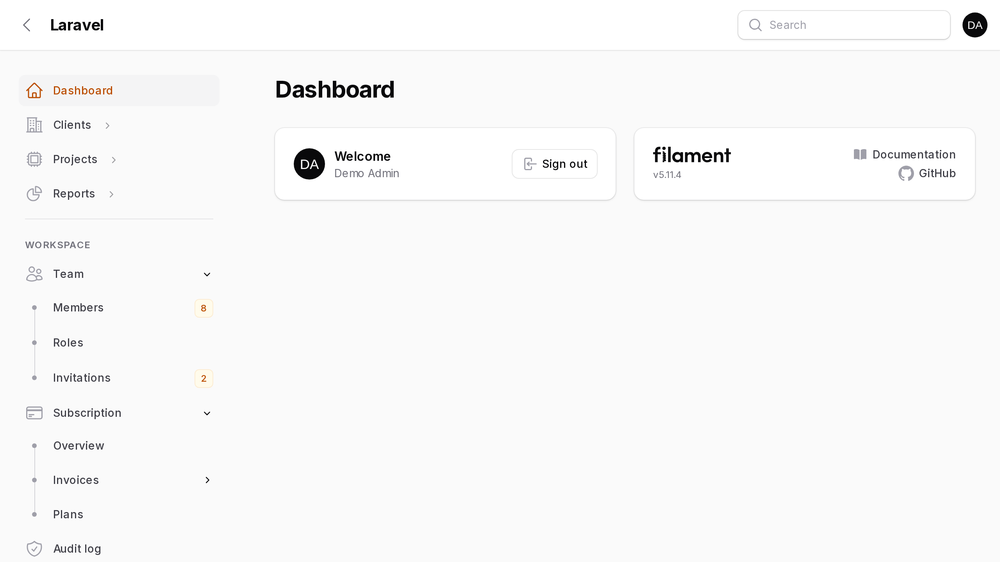 |  |

| Collapsed: top level | Collapsed: inside a project |
|---|---|
| 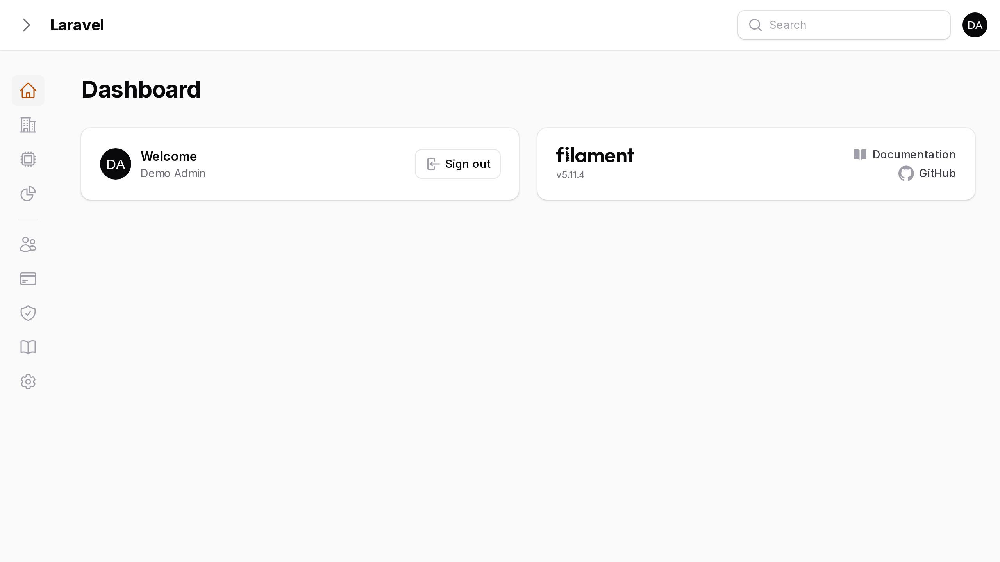 |  |

> Tip: give top-level items an icon. In the collapsed sidebar, an item without an icon has nothing to show.

## Multi-panel, Octane, tenants, languages

- **Several panels:** register the plugin on any panel, each with its own tree. A panel without it keeps Filament's own sidebar. (Demo: `admin`, `portal`, `plain`.)
- **Octane / long-lived workers:** safe. Request-specific state (item tree, children, record lookups) lives in a request-scoped binding that is discarded after each request. Pass a **closure** to `items()` so menus can depend on the user, tenant or database; static `NavItem`s built once are fine for static menus. Verified with simulated worker reuse in the tests and with a real RoadRunner worker (see Quality).
- **Tenancy and domains:** Home and Back use `Panel::getUrl($tenant)`, so `https://app.test/admin/{tenant}` and panels on their own domain work. (Demo: `workspace` panel with tenancy on `workspace.localhost`.)
- **Languages:** "Back" and the navigation landmark are translated in English, 简体中文, 繁體中文 (`zh_TW`, `zh_HK`), 日本語, 한국어 and Español. Publish to change them: `php artisan vendor:publish --tag=filament-drilldown-nav-translations`. Your item labels are your own to translate. Right-to-left layouts are covered by CSS (mirrored chevrons and animation) but not yet tested with an RTL language.

| Japanese UI | Second panel with its own tree |
|---|---|
| 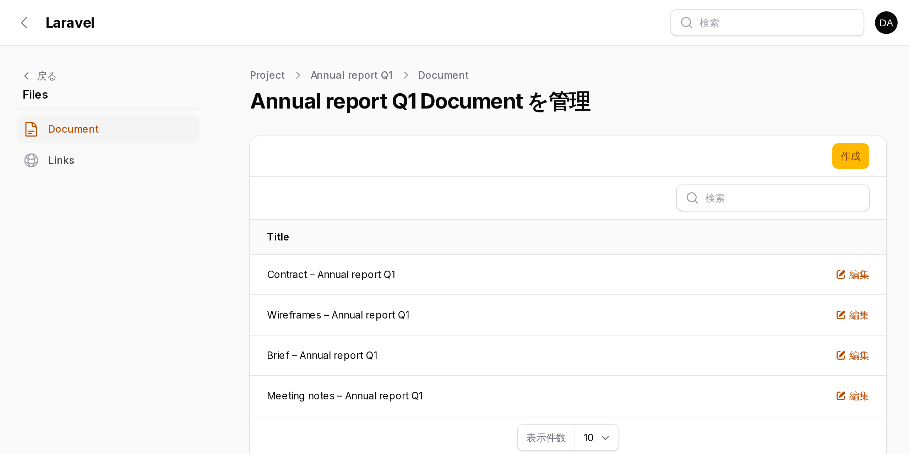 | 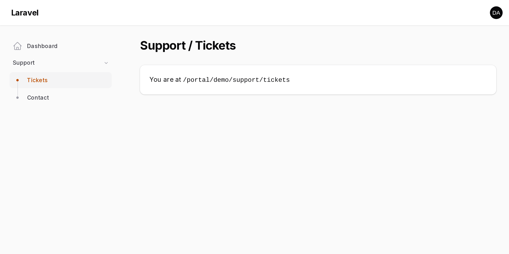 |

## Demo app: a small agency's client portal

`demo/` is a Laravel 13 + Filament v5 app wired to the package via a path repository. It is a realistic back office, not a toy: about **3,000 rows** (12 clients, ~56 projects, ~760 tasks, ~225 documents, ~146 invoices, ~1,330 time entries) and **four roles**.

| Area | What it shows |
|---|---|
| **Clients** (staff only) | table → click a client → its own menu: Overview, **Projects** (opens a level listing that client's projects, with a count badge), **Invoices** (a nested resource, badge = unpaid invoices), Contacts |
| **Projects** | table → click a project → its menu: Overview, **Tasks** (nested resource, badge = open tasks), Time, Files → Documents / Links, Settings |
| **Tasks** | each task has its own menu (Details, Comments, History): **five levels**: Projects → Project → Tasks → Task → Comments |
| **Roles** | `admin`, `manager`, `member`, `client`: menus and pages differ (a client login sees only its own client's projects and never Clients, Time or Settings) |
| **Reports** | a group imported from native Filament navigation: sort order, group icon, badge, native parent item, permission-gated page |
| **Workspace** | click-to-expand sections with a heading and divider, nested expand, remembered state |
| Other panels | `portal` (second tree, inline by default), `plain` (no plugin), `workspace` (tenancy + domain) |

```bash
cd demo
composer install
cp .env.example .env && php artisan key:generate
touch database/database.sqlite && php artisan migrate --seed
php artisan serve
```

Log in at `/admin/login` (password `password`, local demo data only):

| Email | Role | Sees |
|---|---|---|
| `demo@example.com` | admin | everything, including *Audit log* and *Billing* |
| `manager@example.com` | manager | Clients, projects, invoices |
| `member@example.com` | member | projects and tasks |
| `client@example.com` | client (Acme Corp) | only Acme's projects; no Clients, Time or Settings |

| Client menu (real badges) | A client's projects, as a level |
|---|---|
| 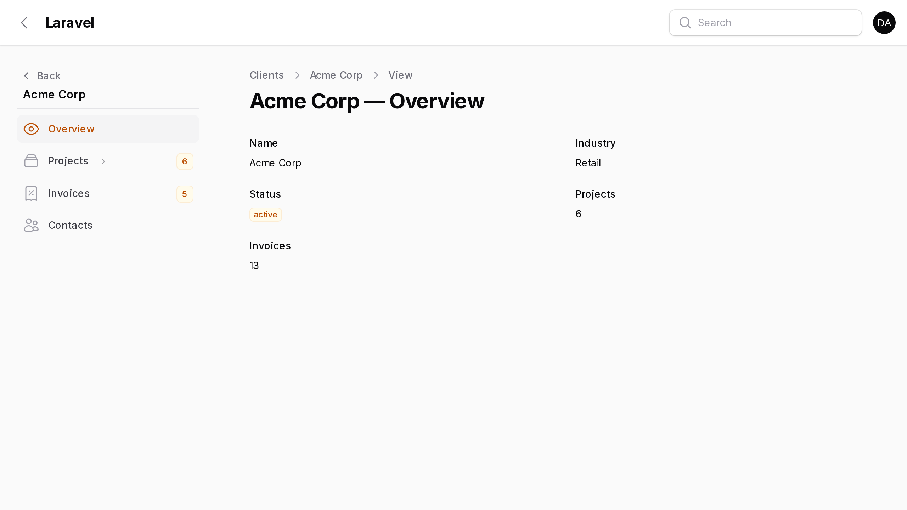 | 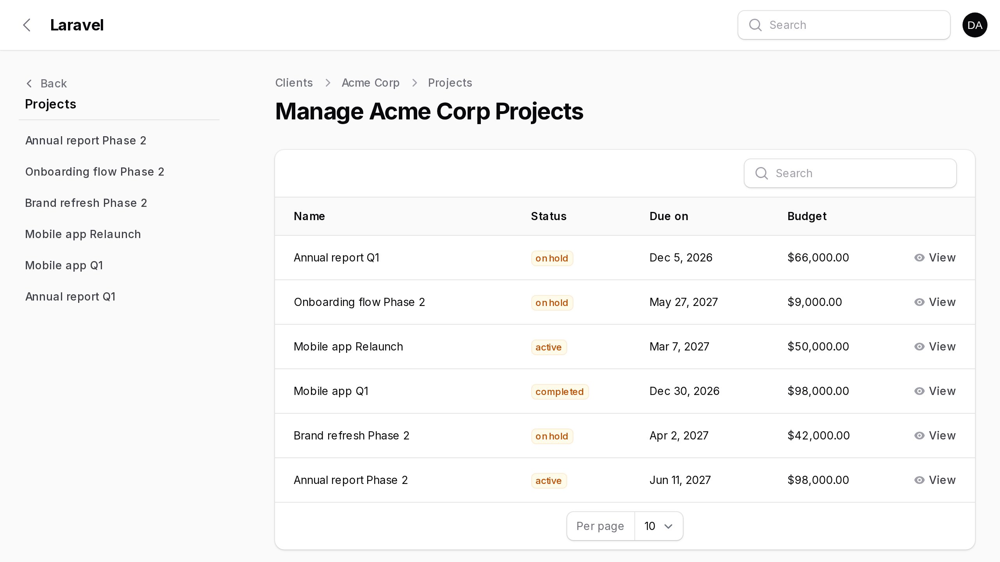 |
| **Project menu (open-task badge)** | **Level 4: one task, its own menu** |
| 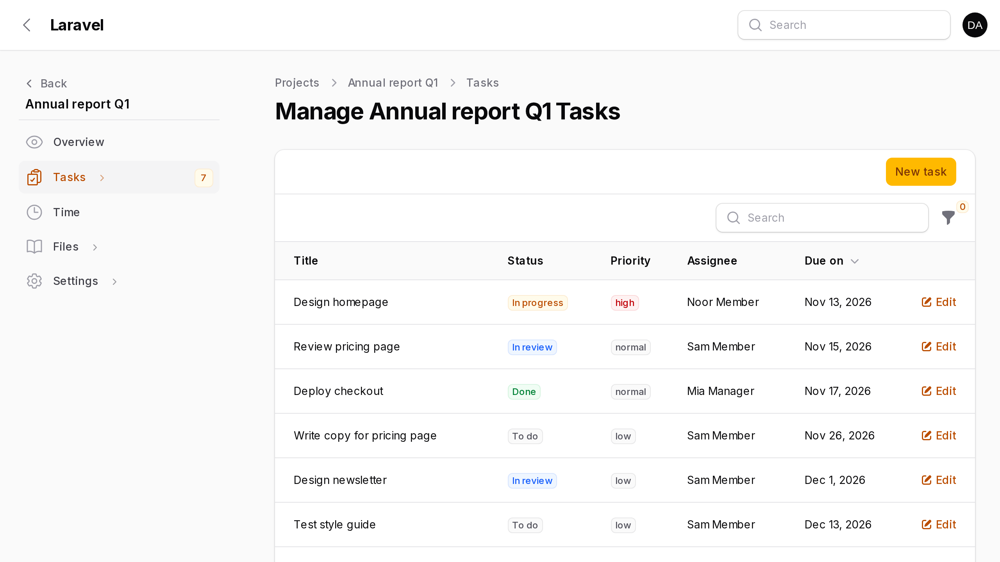 | 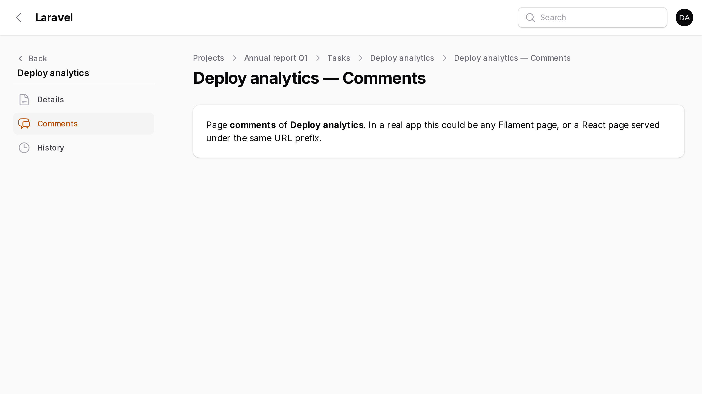 |
| **Same project as a client login** | **Staff top level** |
| 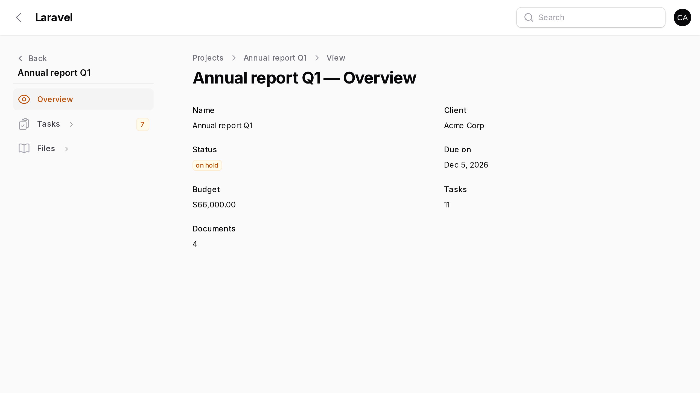 | 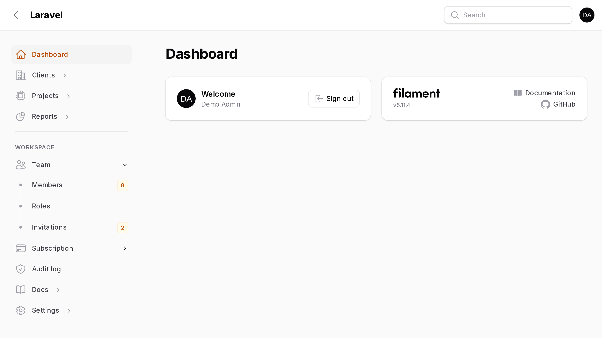 |

<details>
<summary>More screenshots</summary>

| Projects table | Nested resource inside an project |
|---|---|
| 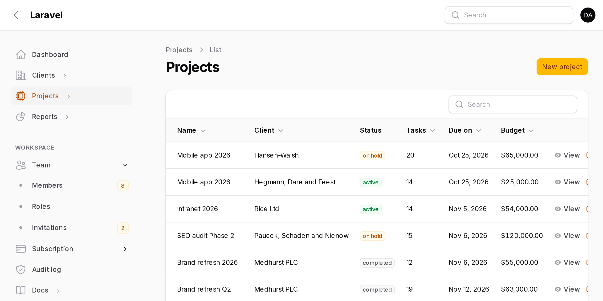 |  |

| Native parent item (Usage → By project) | Dark mode |
|---|---|
|  | 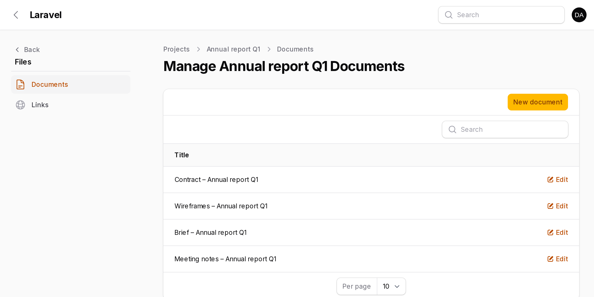 |

| Mobile drawer |
|---|
|  |

</details>

## Quality

```bash
composer check                  # Pint + PHPStan (level 9, no baseline) + Pest
cd demo && php artisan test     # feature tests: real pages rendered through the panel
```

- **Pest** (package): URL matching, level selection, groups, per-record menus, nested sub menus, once-per-request evaluation, ignored keys, failing lookups.
- **Demo feature tests**: each level, record menus, nested resources, native navigation import, badges, permissions, no duplicates; plus tests on the seeded agency (row counts, real badge numbers, all table pages with real rows, the five-level path, each role's menu, client data isolation, a query budget per page).
- **PHPStan level 9** on `src/`, with no ignores.
- **Worker reuse:** tests serve several requests with one application (scoped state dropped, facades cleared, as Octane does) across panels, users, tenants and records. A real RoadRunner/Octane worker (one worker, three rounds of alternating users and panels, a record changed in the database between requests) was also checked by hand; that run is not part of CI.
- **Languages:** every shipped language is tested for rendering and for having the same keys.
- **Modern navigation:** expand/collapse state, nesting, headings, dividers, chevrons, the collapsed mode and the focus target are tested in the demo and with a real browser (click, keyboard, reload, collapse); the tests were checked by mutation (breaking the feature makes them fail).
- CI (`.github/workflows/tests.yml`) runs everything on a **self-hosted** runner; fork pull requests are skipped.

## Documentation

- [How it works](docs/how-it-works.md) — problem, request flow, record menus, native navigation, class overview.
- [AGENTS.md](AGENTS.md) — for people and AI agents changing this repo.
- [SKILLS.md](SKILLS.md) — for AI agents adding the plugin to a Filament app.

## Limits

The plugin owns the sidebar list, so items you do not list (or import) are not shown.

## License

MIT
