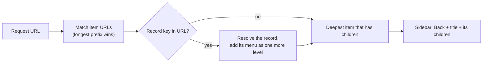
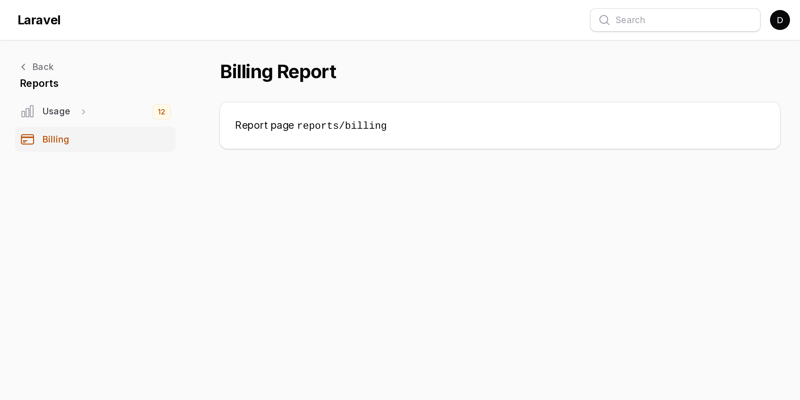
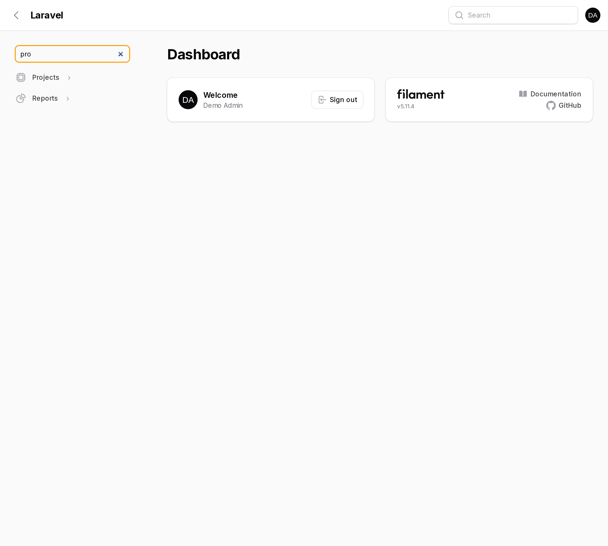
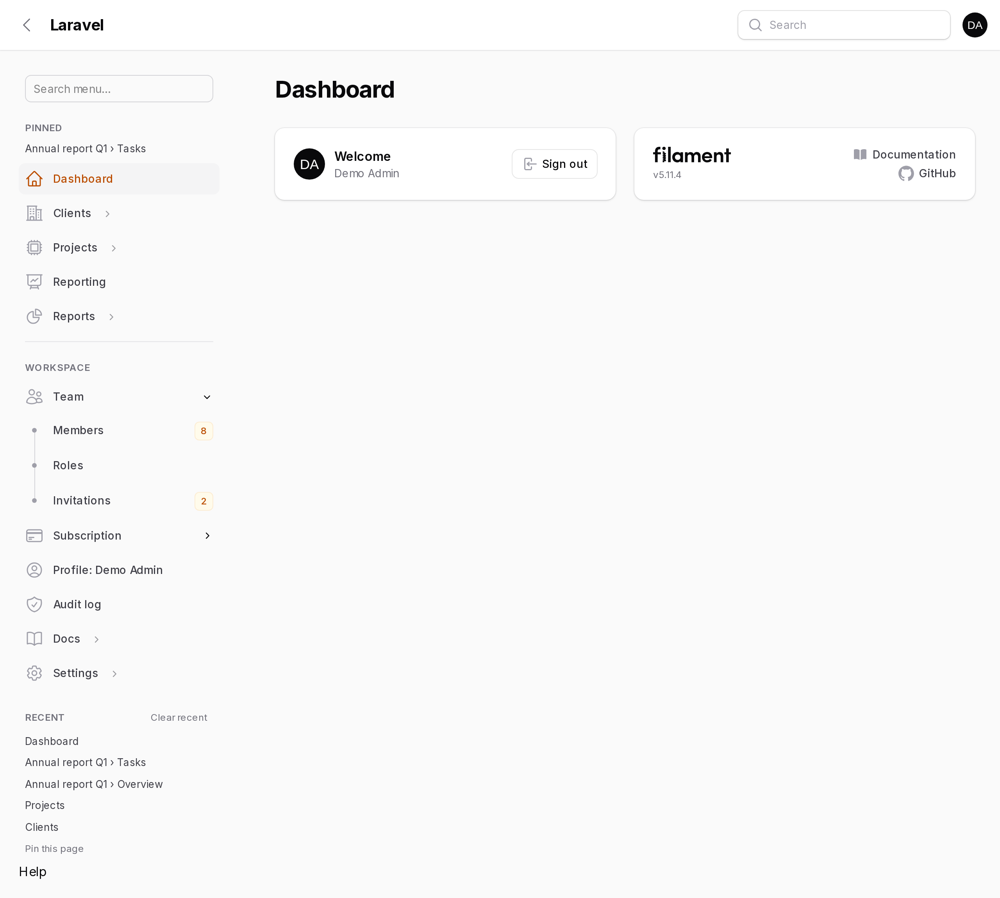

# Filament Drilldown Nav

Drill-down sidebar navigation for **Filament v5**: one left sidebar, **one level at a time**, a **Back** link, any depth — and a **menu per record** (click an project, get that project's own menu).


## Why

Filament's sidebar nests everything in place, and a cluster's or page's sub-navigation appears as a *second* menu beside the content. That is fine for two levels. It gets awkward when a record has its own area with its own sub menus (3–4 levels) and you want it all in **one** place.

| You want | Filament alone | This plugin |
|---|---|---|
| A menu for one record (project, site, customer …) | build a sub-navigation per page | `->record(fn ($record) => [...])` |
| 3–4 levels in the left sidebar | groups + one parent level | any depth |
| One menu location | sidebar **and** sub-navigation | the sidebar |
| Keep `$navigationGroup`, `$navigationParentItem`, badges, `canAccess()` | — | `NavItem::fromFilamentNavigation()` |

> If two levels are enough for you, Filament's native groups, parent items and Clusters are simpler. Use this plugin when you need more depth or a menu per record.

## How it works (short)

The level you see is computed **on the server from the URL, on every request**: no JavaScript state, so refreshes and shared links land in the right place.



Full explanation with more diagrams (level selection, per-record sequence, native navigation reuse, class overview): **[docs/how-it-works.md](docs/how-it-works.md)**.

## Requirements

PHP 8.3+, Laravel 13, Filament **5.7** or later (the oldest version tested in CI). Run a patched Filament: versions below 5.8.3 have published security advisories, which Composer blocks by default.

## Install

Not on Packagist yet:

```bash
composer config repositories.drilldown vcs https://github.com/solutionforest/filament-drilldown-nav
composer require solutionforest/filament-drilldown-nav:dev-main
php artisan filament:assets   # publishes the plugin's stylesheet (also run by `php artisan filament:upgrade`)
```

## Quick start

```php
use SolutionForest\DrilldownNav\DrilldownNavPlugin;
use SolutionForest\DrilldownNav\Tree\NavItem;

$panel->plugin(DrilldownNavPlugin::make()->items(fn () => [
    NavItem::page(Dashboard::class),                       // label, icon, URL, access from the class

    NavItem::resource(ProjectResource::class)                // list = a normal Filament table
        ->record(fn (Project $project) => [                    // menu shown INSIDE one project
            NavItem::make('Overview')->icon('heroicon-o-eye')
                ->url(ProjectResource::getUrl('view', ['record' => $project])),
            NavItem::make('Tasks')->icon('heroicon-o-clipboard-document-check')
                ->url(ProjectResource::getUrl('section', ['record' => $project, 'section' => 'tasks'])),
            NavItem::make('Files')->icon('heroicon-o-book-open')->children([   // a sub menu
                NavItem::resource(DocumentResource::class, ['project' => $project]),   // nested resource
                NavItem::make('Links')->url(ProjectResource::getUrl('section', ['record' => $project, 'section' => 'links'])),
            ]),
        ]),

    ...NavItem::fromFilamentNavigation(),                  // everything else Filament would show
]));
```

In the sidebar, the plugin's menu replaces Filament's own list: **only items returned from `items()` are shown there.** Everywhere else Filament's navigation is untouched: `->topNavigation()` still shows the native menu in the top bar (the drill-down menu is then in the mobile drawer), and breadcrumbs or other plugins that call `Filament::getNavigation()` still get the full list.

> **Custom sidebar component?** The plugin swaps in its own sidebar Livewire component (`DrilldownSidebar`, a subclass of Filament's). If your panel already sets `->sidebarLivewireComponent(...)`, the plugin leaves yours alone; add the `SolutionForest\DrilldownNav\Livewire\Concerns\HidesNativeNavigation` trait to it, or Filament's list will show under the drill-down menu.

## Tutorial

### 1. Pages, resources and plain URLs

```php
NavItem::page(Dashboard::class);                 // Filament Page
NavItem::resource(SiteResource::class);          // Filament Resource (list URL)
NavItem::make('Reports')->icon('heroicon-o-chart-bar')->url('/admin/reports')->badge('3', 'danger'); // any URL, e.g. a React page
```

### 2. Nested levels

```php
NavItem::make('Docs')->url('/admin/docs')->children([
    NavItem::make('Guides')->url('/admin/docs/guides')->children([
        NavItem::make('Install')->url('/admin/docs/guides/install'),
    ]),
]);
```

An item with children opens its own level when you visit its URL. An item **without a URL** is a pure group: clicking it goes to its first child.

| Level 4 | Reports (native group, badge) |
|---|---|
|  |  |

### 3. A menu per record

`record()` is the feature this plugin exists for. When the URL is `<list URL>/<key>/…` (and the key is not `create`), the key is resolved with the resource's own route binding and the sidebar shows your menu, titled with the record's title. Back returns to the list.

```php
NavItem::resource(ProjectResource::class)->record(fn (Project $project) => [ /* any NavItems, any depth */ ]);
```

| One project's menu | Sub menu inside it |
|---|---|
|  |  |

Record-menu URLs must live under the resource's own URL (`/admin/projects/{record}/…`), because that is how the plugin knows you are inside the record. Register extra pages on the resource, **after** `edit`:

```php
'edit' => EditProject::route('/{record}/edit'),
'section' => ProjectSection::route('/{record}/{section}'),
```

For a non-resource item use `->resolveRecordUsing(fn (string $key) => …)` and `->recordTitleUsing(fn ($record) => …)`. Fixed pages below the list URL (like `/projects/import`) are never mistaken for a record: they are excluded automatically for `resource()`, or with `->ignoreRecordKeys(['create', 'import'])`.

#### Your own header for a level

A level normally starts with **Back** and its title. Replace that with your own view, for example a card with the record's status and a switcher, with `->recordHeader()` (for a record's menu) or `->header()` (for any item that opens a level):

```php
NavItem::resource(TaskResource::class, ['project' => $project])
    ->recordHeader(fn (Task $task) => view('filament.nav.task-header', [
        'task' => $task,
        'backUrl' => TaskResource::getIndexUrl(['project' => $project]),
    ]))
    ->record(fn (Task $task) => [ /* ... */ ]);
```

A view (any `Htmlable`) is rendered as HTML, a string as escaped text, and `null` keeps the default. The header replaces Back too, so include a link back yourself. It receives keyboard focus when you drill in or out, like the default title. In the collapsed sidebar it is shown as you wrote it, so hide what does not fit with `x-show="$store.sidebar.isOpen"`. (Demo: one task's menu.)

#### Pages that live elsewhere

An item is current when the URL starts with its own URL. When some of its pages live under another URL, list those with `->activeOn()`; they match the same way:

```php
NavItem::make('Knowledge')
    ->url(AgentResource::getUrl('knowledge', ['record' => $agent]))       // /agents/5/sources
    ->activeOn([KnowledgeDocumentResource::getIndexUrl(['agent' => $agent])]); // /agents/5/knowledge/{id}, …/create
```

When the URL cannot place a page at all (a shared route, a tab in the query string, a React route), use `->activeWhen()` with any condition:

```php
NavItem::make('Exports')->url('/admin/reports/exports')
    ->activeWhen(fn (): bool => request()->routeIs('downloads.*'));
```

It counts as an exact URL match (if another item matches the URL exactly, the deeper one wins) and runs at most once per request. It is found inside branches given as arrays; children built by a closure are only opened on the current path, so put `activeWhen()` items there only if their parent also matches.

### 4. Reuse Filament's own navigation

Anything you already declare the Filament way keeps working (`$navigationGroup`, `$navigationParentItem`, `$navigationSort`, `$navigationBadge`, `shouldRegisterNavigation()`, `canAccess()`, `NavigationItem::make()`):

```php
...NavItem::fromFilamentNavigation(
    fn (NavigationItem $item): bool => $item->getUrl() !== Dashboard::getUrl() // leave out what you list by hand
)
```

Groups become URL-less groups (with the group icon you registered on the panel), parent items become sub levels, badges and access checks carry over. See the *Reports* group in the demo.

### 5. Visibility and badges

```php
NavItem::make('Billing')->visible(fn () => auth()->user()->isAdmin());
NavItem::make('Inbox')->badge(fn () => (string) Message::unread()->count(), 'danger');
```

Empty groups disappear. Closures run once per request, and only for items on the current path.

## Modern navigation: click to expand, lines, icons, sections

Besides drilling into a new level, an item's children can **expand in place**, like a classic tree:

```php
NavItem::heading('Workspace')->divider(),                       // section heading + a line above it

NavItem::make('Team')->icon('heroicon-o-users')
    ->inline()                                                  // children expand under the item
    ->defaultExpanded()                                         // start open (otherwise: closed, remembered)
    ->children([
        NavItem::make('Members')->url('/admin/team/members')->badge('8'),
        NavItem::make('Invitations')->url('/admin/team/invitations')->badge('2', 'warning'),
    ]),

NavItem::make('Subscription')->icon('heroicon-o-credit-card')->inline()->children([   // nesting works
    NavItem::make('Overview')->url('/admin/subscription'),
    NavItem::make('Invoices')->inline()->children([ /* ... */ ]),
]),
```

| | |
|---|---|
| `->inline()` / `->drilldown()` | per item: expand in place, or open a new level (the default) |
| `DrilldownNavPlugin::make()->childDisplay(ChildDisplay::Inline)` | change the default for the whole panel (items can still override) |
| `->defaultExpanded()` | inline items start open; otherwise the open/closed state is remembered per browser |
| `NavItem::heading('…')`, `->divider()` | non-clickable section headings and separator lines |
| `->icon()`, `->activeIcon()`, `->badge()` | icons (outline/solid when current) and badges; icon-less nested items get Filament's guide line and dot |

What you get without extra code: the section containing the current page is **open** and its parents marked; guide lines for nested items (Filament's own style); chevrons that rotate; state remembered across page loads; **collapsed (icon-only) sidebar** when the panel uses `->sidebarCollapsibleOnDesktop()` (labels, titles and badges hide, Back keeps its arrow with a tooltip, tooltips on items); keyboard-operable toggle buttons with `aria-expanded`; `aria-current="page"` on the current item; a labelled `nav` landmark; focus moves to the new level's title when you drill in or out; `prefers-reduced-motion` respected; and mirrored chevrons, Back arrow and animation for right-to-left pages (checked with Arabic).

| Expand in place (`->inline()`) | Nested, with guide lines |
|---|---|
|  |  |

| Collapsed: top level | Collapsed: inside a project |
|---|---|
|  |  |

In the collapsed sidebar, a top-level item without an icon shows its **initial** in a small square, so it stays visible and clickable (with the label as tooltip). Icons still read better: give top-level items an icon where you can.

## Large menus: search, recent, pinned, long lists

```php
DrilldownNavPlugin::make()
    ->searchable(minItems: 6)   // a filter box once a level lists 6+ items
    ->recent(5)                 // the last 5 pages visited, at the top level
    ->pinnable()                // "Pin this page" + a Pinned list
    ->items(fn () => [
        NavItem::make('Projects')->url('/admin/clients/1/projects')
            ->children(fn () => $client->projects()->limit(40)->get()->map(fn ($p) => NavItem::make($p->name)->url(…))->all())
            ->limit(5, '/admin/clients/1/projects'),   // show 5, then "View all (N)"
    ]);
```

- **Search** filters what is already on screen (the current level and inline sections) as you type: a section stays visible when a child matches, headings hide, `Esc` clears, and a note appears when nothing matches. It does **not** search levels you have not opened (those pages are separate; use Filament's global search for that).
- **Recent / Pinned** *(experimental, may change before 1.0)* are stored in the browser per panel, tenant and user, show at the top level, and remember the page's trail (e.g. "Website redesign › Tasks"). The pin toggle appears on every level. Only entries under the current panel (and tenant) URL are shown. They are links, not permissions: a pinned page the user can no longer open still shows until it is unpinned, and opening it gets Filament's usual 403/404.
- **`->limit($max, $moreUrl)`** shortens the **display** of a long child list; it does not make big menus cheaper. All children still take part in URL matching and the child containing the current page is never hidden, so the sidebar stays correct. Keep your own query small (`limit()` on the query): it shortens the display, it does not avoid loading the rows.

| Search | Pinned + Recent |
|---|---|
|  |  |

## Render hooks: add your own content around the menu

The sidebar exposes [Filament render hooks](https://filamentphp.com/docs/5.x/advanced/render-hooks), so you can add a help link, a workspace switcher or a banner without publishing or overriding the plugin's views:

```php
use SolutionForest\DrilldownNav\DrilldownNavHook;

$panel
    ->renderHook(DrilldownNavHook::NAV_END, fn () => view('nav-help-link'))
    ->renderHook(DrilldownNavHook::HEADER_AFTER, fn (array $data) => view('level-note', ['title' => $data['title']]));
// or anywhere: FilamentView::registerRenderHook(DrilldownNavHook::NAV_END, fn () => …, scopes: 'admin');
```

| Hook | Where |
|---|---|
| `NAV_START` / `NAV_END` | first / last thing inside the navigation |
| `HEADER_BEFORE` / `HEADER_AFTER` | around the Back link and title (only on levels that have one) |
| `LIST_BEFORE` / `LIST_AFTER` | around the list of items |

Every hook is scoped to the id of the panel being rendered, so a hook registered for `admin` never shows in another panel. A closure may declare `array $data`, which holds `plugin`, `panel`, `depth` (0 = top level) and `title`.

## Multi-panel, Octane, tenants, languages

- **Several panels:** register the plugin on any panel, each with its own tree. A panel without it keeps Filament's own sidebar. (Demo: `admin`, `portal`, `plain`.)
- **Octane / long-lived workers:** safe. Request-specific state (item tree, children, record lookups) lives in a request-scoped binding that is discarded after each request. Pass a **closure** to `items()` so menus can depend on the user, tenant or database; static `NavItem`s built once are fine for static menus. Verified with simulated worker reuse in the tests and with **real Octane workers on RoadRunner, Swoole and FrankenPHP** (run in CI, see Quality).
- **Tenancy and domains:** Home and Back use `Panel::getUrl($tenant)`, so `https://app.test/admin/{tenant}` and panels on their own domain work. (Demo: `workspace` panel with tenancy on `workspace.localhost`.)
- **Languages:** the plugin's own text ("Back", the landmark, search, pin …) is translated in English, 简体中文, 繁體中文 (`zh_TW`, `zh_HK`), 日本語, 한국어, Español and the right-to-left languages العربية, עברית, فارسی and اردو (Arabic was checked in a browser; Hebrew, Persian and Urdu are machine-written and share the same rules, so a native-speaker review is welcome). Publish to change them: `php artisan vendor:publish --tag=filament-drilldown-nav-translations`. Your item labels are your own to translate. Right-to-left is supported: with an RTL locale the chevrons, Back arrow and slide animation mirror (checked in a browser with Arabic).

| Japanese UI | Second panel with its own tree |
|---|---|
|  |  |
| **Arabic (right-to-left): top level** | **Arabic: inside a project** |
|  |  |

## Demo app: a small agency's client portal

`demo/` is a Laravel 13 + Filament v5 app wired to the package via a path repository. It is a realistic back office, not a toy: about **3,000 rows** (12 clients, ~56 projects, ~760 tasks, ~225 documents, ~146 invoices, ~1,330 time entries) and **four roles**.

| Area | What it shows |
|---|---|
| **Clients** (staff only) | table → click a client → its own menu: Overview, **Projects** (opens a level listing that client's projects, with a count badge), **Invoices** (a nested resource, badge = unpaid invoices), Contacts |
| **Projects** | table → click a project → its menu: Overview, **Tasks** (nested resource, badge = open tasks), Time, Files → Documents / Links, Settings |
| **Tasks** | each task has its own menu (Details, Comments, History) under a custom header (`recordHeader()`: All tasks, title, status): **five levels**: Projects → Project → Tasks → Task → Comments |
| **Roles** | `admin`, `manager`, `member`, `client`: menus and pages differ (a client login sees only its own client's projects and never Clients, Time or Settings) |
| **Reports** | a group imported from native Filament navigation: sort order, group icon, badge, native parent item, permission-gated page |
| **Workspace** | click-to-expand sections with a heading and divider, nested expand, remembered state |
| Other panels | `portal` (second tree, inline by default), `plain` (no plugin), `workspace` (tenancy + domain) |

```bash
cd demo
composer install
cp .env.example .env && php artisan key:generate
touch database/database.sqlite && php artisan migrate --seed
php artisan serve
```

Log in at `/admin/login` (password `password`, local demo data only):

| Email | Role | Sees |
|---|---|---|
| `demo@example.com` | admin | everything, including *Audit log* and *Billing* |
| `manager@example.com` | manager | Clients, projects, invoices |
| `member@example.com` | member | projects and tasks |
| `client@example.com` | client (Acme Corp) | only Acme's projects; no Clients, Time or Settings |

| Client menu (real badges) | A client's projects, as a level |
|---|---|
|  |  |
| **Project menu (open-task badge)** | **Level 4: one task, its own menu** |
|  |  |
| **Same project as a client login** | **Staff top level** |
|  |  |

<details>
<summary>More screenshots</summary>

| Projects table | Nested resource inside an project |
|---|---|
|  |  |

| Native parent item (Usage → By project) | Dark mode |
|---|---|
|  |  |

| Mobile drawer |
|---|
|  |

</details>

## Quality

```bash
composer check                  # Pint + PHPStan (level 10, no baseline) + Pest
cd demo && php artisan test     # feature tests: real pages rendered through the panel
```

- **Pest** (package): URL matching, level selection, groups, per-record menus, nested sub menus, once-per-request evaluation, ignored keys, failing lookups.
- **Demo feature tests**: each level, record menus, nested resources, native navigation import, badges, permissions, no duplicates; plus tests on the seeded agency (row counts, real badge numbers, all table pages with real rows, the five-level path, each role's menu, client data isolation, a query budget per page).
- **PHPStan level 10** (the strictest level) on `src/`, with no ignores.
- **Worker reuse:** tests serve several requests with one application (scoped state dropped, facades cleared, as Octane does) across panels, users, tenants and records. In addition, `demo/bin/octane-smoke.sh <roadrunner|swoole|frankenphp>` starts a **real one-worker Octane server** and runs 21 checks (two users and three panels alternating over three rounds, a record renamed between requests); CI runs it for all three servers. The script was checked by mutation: making the plugin's request state outlive the request makes it fail.
- **Languages:** every shipped language is tested for rendering and for having the same keys; the four right-to-left languages are checked for `dir="rtl"` and the mirroring rules, and Arabic in a browser.
- **Filament versions:** the whole demo suite and the real-server smoke test pass on Filament 5.7.0 (the oldest supported) and on the latest 5.x; a CI job runs the oldest.
- **Clusters:** a Filament cluster next to the plugin appears in the menu and keeps its own sub-navigation (tested).
- **Search, recent, pinned, limit:** markup, per-user storage keys, translations, and the limit logic are tested; the browser behaviour (typing, filtering, Esc, pinning, clearing, reload) was run in a real browser.
- **Modern navigation:** expand/collapse state, nesting, headings, dividers, chevrons, the collapsed mode and the focus target are tested in the demo and with a real browser (click, keyboard, reload, collapse); the tests were checked by mutation (breaking the feature makes them fail).
- CI (`.github/workflows/tests.yml`) runs everything on a **self-hosted** runner; fork pull requests are skipped.

## Documentation

- [How it works](docs/how-it-works.md) — problem, request flow, record menus, native navigation, class overview.
- [This plugin or Filament's own navigation?](docs/vs-filament-native.md) — a decision guide.
- [API stability](docs/api-stability.md) — what is public, what may change, and what 1.0 needs.
- [Changelog](CHANGELOG.md).
- [AGENTS.md](AGENTS.md) — for people and AI agents changing this repo.
- [SKILLS.md](SKILLS.md) — for AI agents adding the plugin to a Filament app.

## Limits

- In the sidebar, only items you list (or import with `fromFilamentNavigation()`) are shown.
- Levels come from the URL (plus `activeOn()` / `activeWhen()`), so a record's pages should live under the record's URL.
- Search only covers what is on screen; recent and pinned pages are per browser.
- Pinned pages are per browser; a pinned page that stops opening is dropped by a daily check, not instantly.

## License

MIT
