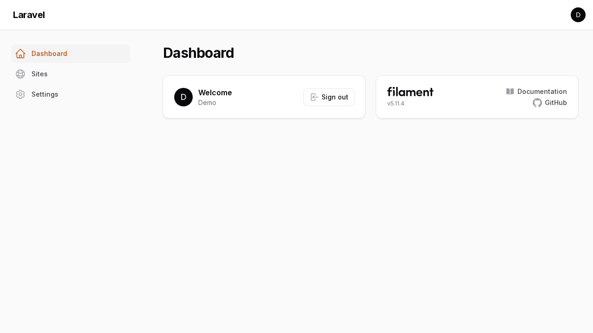
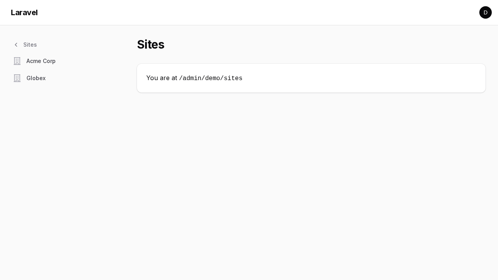
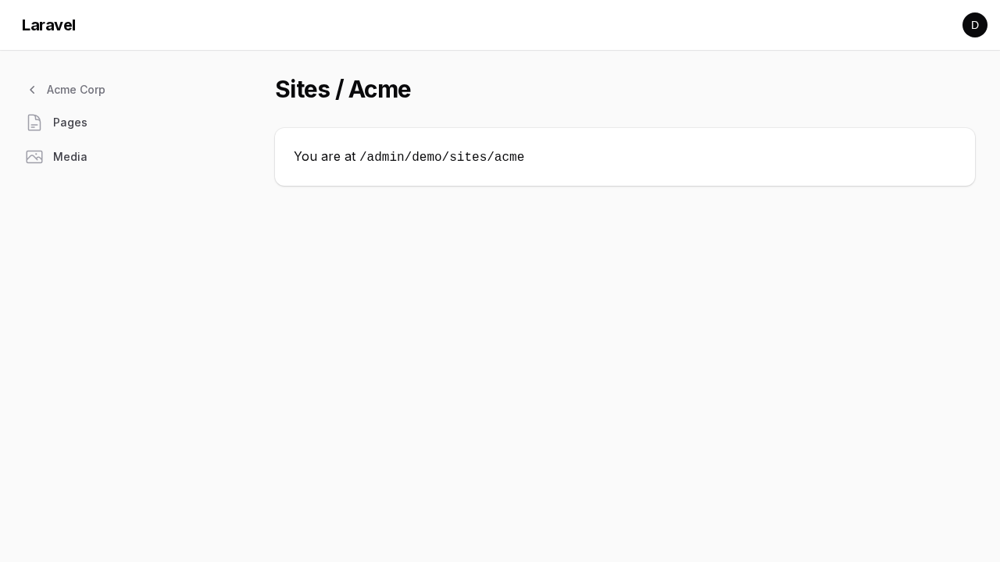
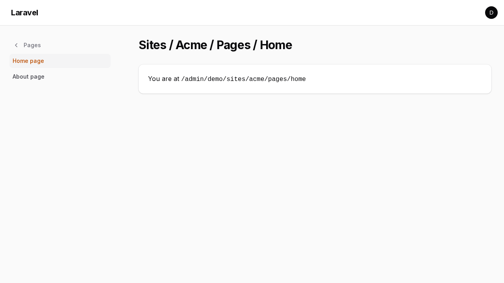

# Filament Drilldown Nav

Drill-down (slide) multi-level sidebar navigation for **Filament v5**.

One left sidebar shows **one level at a time**. Clicking an item that has children slides into that item's own menu, with a **Back** link to the parent. Works at any depth — no nested second-level groups in the sidebar.

> **Status: early spike.** Works in the demo app (4 levels, tested). Not yet done: collapsed (icon-only) sidebar behavior, per-resource/record helpers, route-name matching, `wire:navigate` testing.

| Level 1 | Level 2 |
|---|---|
|  |  |
| **Level 3** | **Level 4** |
|  |  |

## Requirements

PHP 8.3+, Laravel 13, Filament v5.

## Install

Not on Packagist yet. Add the repository to your app's `composer.json`, then require it:

```bash
composer config repositories.drilldown vcs https://github.com/solutionforest/filament-drilldown-nav
composer require solutionforest/filament-drilldown-nav:dev-main
```

## Tutorial

### 1. Register the plugin on your panel

```php
use SolutionForest\DrilldownNav\DrilldownNavPlugin;
use SolutionForest\DrilldownNav\Tree\NavNode;

public function panel(Panel $panel): Panel
{
    return $panel
        ->plugin(DrilldownNavPlugin::make()->tree(fn () => [
            NavNode::make('dashboard', 'Dashboard')->icon('heroicon-o-home')->url('/admin'),

            NavNode::make('sites', 'Sites')->icon('heroicon-o-globe-alt')->url('/admin/sites')->children([
                NavNode::make('acme', 'Acme Corp')->url('/admin/sites/acme')->children([
                    NavNode::make('pages', 'Pages')->url('/admin/sites/acme/pages')->children([
                        NavNode::make('home', 'Home page')->url('/admin/sites/acme/pages/home'),
                    ]),
                    NavNode::make('media', 'Media')->url('/admin/sites/acme/media'),
                ]),
            ]),
        ]));
}
```

The plugin empties Filament's native navigation (keeping the sidebar shell, mobile drawer and topbar) and renders the drill-down menu in its place.

### 2. How the current level is chosen

On every request the plugin matches the request path against node URLs (**longest prefix wins**) to get the path `root → … → current`. It renders the children of the **deepest node on that path that has children**, plus a Back link to that node's parent. Unknown URLs fall back to the root level. Because this is resolved server-side, deep links and refreshes always land on the right level.

### 3. Dynamic and conditional nodes

`children()` and `visible()` accept closures, so a menu can depend on data or permissions:

```php
NavNode::make('site', $site->name)
    ->url("/admin/sites/{$site->id}")
    ->children(fn () => $site->pages->map(fn ($p) => NavNode::make("page-{$p->id}", $p->title)->url("/admin/pages/{$p->id}"))->all())
    ->visible(fn () => auth()->user()->can('view', $site));
```

Nodes are plain links (any URL), so custom Filament pages, Resources and React/Inertia pages served inside the panel can all be nodes.

## Demo app

`demo/` is a Laravel 13 + Filament v5 app wired to the package via a path repository.

```bash
cd demo
composer install
cp .env.example .env && php artisan key:generate
touch database/database.sqlite && php artisan migrate
php artisan make:filament-user      # or use your own credentials
php artisan serve
```

Open `/admin`, then click **Sites → Acme Corp → Pages** to drill down; use the Back link to go up.

## Tests & CI

```bash
vendor/bin/pest                 # package: path resolution / level selection
vendor/bin/pint --test          # code style
cd demo && php artisan test     # demo: renders each level through the real panel
```

GitHub Actions (`.github/workflows/tests.yml`) runs all of the above on a **self-hosted** runner (`runs-on: self-hosted`), which needs PHP 8.3+ and Composer installed.

## License

MIT
