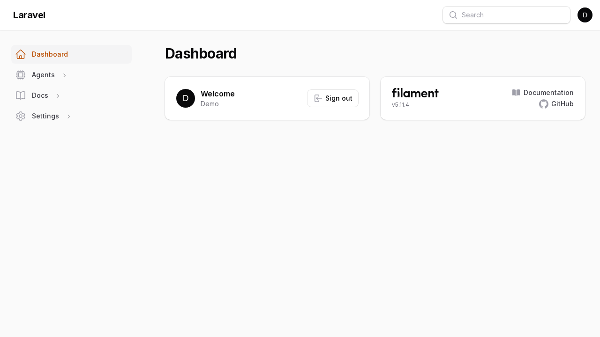
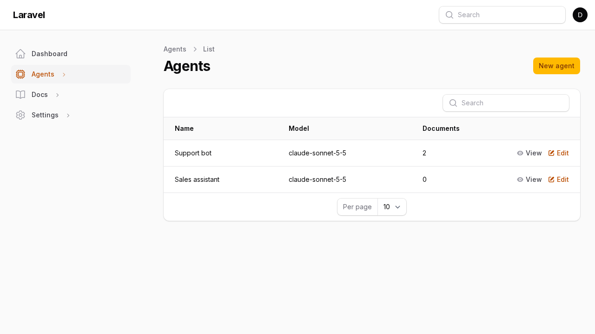
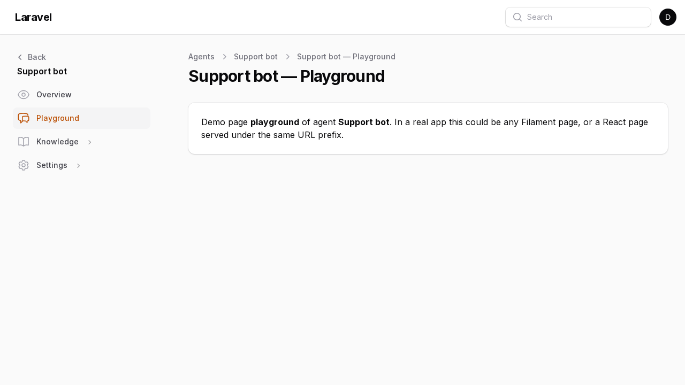
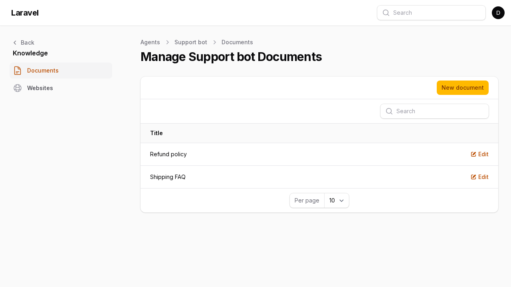
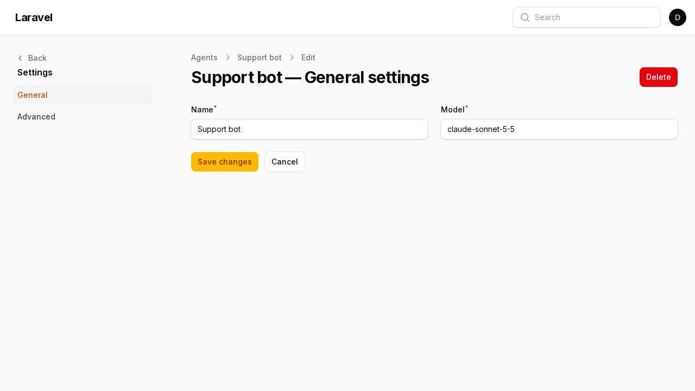
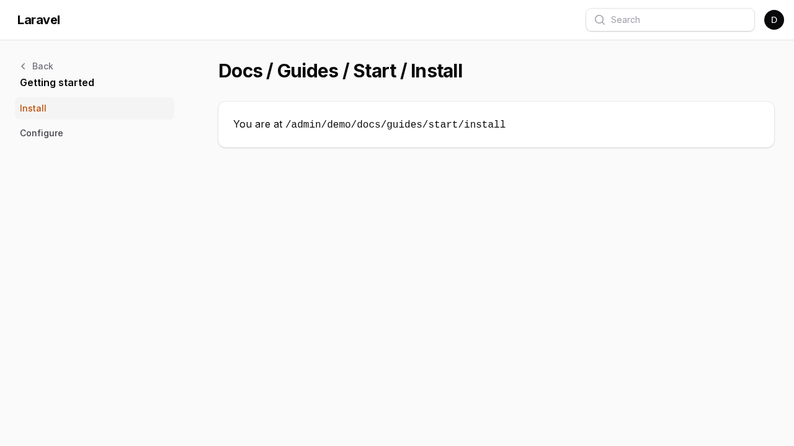
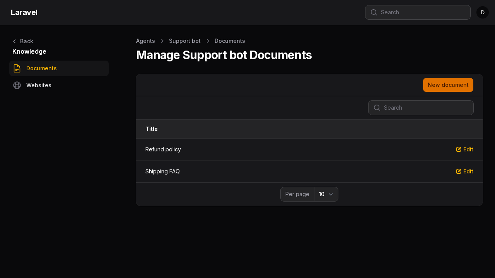
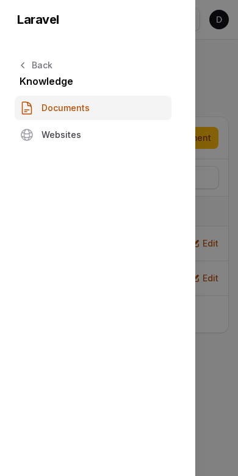

# Filament Drilldown Nav

Drill-down (slide) multi-level sidebar navigation for **Filament v5**.

One left sidebar shows **one level at a time**. Clicking an item that has children replaces the list with that item's own menu, with a **Back** link and the section title. Works at any depth, including **inside a single record**: click an agent in a table and the sidebar becomes that agent's own menu (Playground, Knowledge → Documents / Websites, Settings → General / Advanced).

> **Status: early.** Checked in a real browser in the demo app: levels, record menus with sub menus, light and dark mode, the mobile drawer, and SPA mode (`->spa()`). Not done yet: collapsed (icon-only) sidebar behaviour.

| Main menu | Agents (a normal Filament table) |
|---|---|
|  |  |
| **Click an agent → its own menu** | **Knowledge → sub menu (nested resource)** |
|  |  |
| **Settings group → sub menu** | **Static tree, level 4** |
|  |  |
| **Dark mode** | **Mobile drawer** |
|  |  |

## Requirements

PHP 8.3+, Laravel 13, Filament v5.

## Install

Not on Packagist yet. Add the repository to your app's `composer.json`, then require it:

```bash
composer config repositories.drilldown vcs https://github.com/solutionforest/filament-drilldown-nav
composer require solutionforest/filament-drilldown-nav:dev-main
```

## Tutorial

### 1. Register the plugin on your panel

```php
use SolutionForest\DrilldownNav\DrilldownNavPlugin;
use SolutionForest\DrilldownNav\Tree\NavItem;

$panel->plugin(DrilldownNavPlugin::make()->items(fn () => [
    NavItem::page(Dashboard::class),                 // label, icon, URL, access from the page class
    NavItem::resource(AgentResource::class),         // label, icon, list URL, access from the resource
    NavItem::make('Reports')->icon('heroicon-o-chart-bar')->url('/admin/reports'), // any URL, e.g. a React page
]));
```

The plugin empties Filament's native navigation (keeping the sidebar shell, topbar and mobile drawer) and renders the drill-down menu instead. **Items you don't list are not shown**, so list every Resource/Page you want in the menu.

### 2. Nested levels

```php
NavItem::make('Docs')->url('/admin/docs')->children([
    NavItem::make('Guides')->url('/admin/docs/guides')->children([
        NavItem::make('Install')->url('/admin/docs/guides/install'),
    ]),
]);
```

An item with children opens its own level when you visit its URL. An item **without a URL** is a pure group: clicking it goes to its first child, and Back from a level under it returns to that group's level.

### 3. A menu per record ("click an agent, get that agent's menu")

```php
NavItem::resource(AgentResource::class)->record(fn (Agent $agent) => [
    NavItem::make('Overview')->url(AgentResource::getUrl('view', ['record' => $agent])),
    NavItem::make('Playground')->url(AgentResource::getUrl('playground', ['record' => $agent])),
    NavItem::make('Knowledge')->children([                                   // sub menu
        NavItem::resource(DocumentResource::class, ['agent' => $agent]),    // nested resource
        NavItem::make('Websites')->url(AgentResource::getUrl('websites', ['record' => $agent])),
    ]),
    NavItem::make('Settings')->children([
        NavItem::make('General')->url(AgentResource::getUrl('edit', ['record' => $agent])),
        NavItem::make('Advanced')->url(...),
    ]),
]);
```

When the URL is `<resource list URL>/<key>/…`, the key is resolved to a record with the resource's own route binding, and the record becomes one more level of the tree: its title is the section title, its menu the items, and Back returns to the list. Record menu items work like any other item: `children()` opens a sub menu, a URL-less item is a group, and you can nest as deep as you need.

Rules worth knowing:

- **Every page of a record must live under `<list URL>/<key>/…`** (e.g. `/admin/agents/7/…`); that is how the plugin knows you are inside the record. Custom resource pages (`'playground' => AgentPlayground::route('/{record}/playground')`) and nested resources (`$parentResource = AgentResource::class`) both do this.
- An item whose URL is the record's own URL (the "Overview" above) is highlighted on that exact page only, not on every page below it.
- `create`, and fixed list-level pages registered on the resource (e.g. `/admin/agents/import`), are never treated as record keys. Add more with `->ignoreRecordKeys(['create', 'import'])`. A key that fails to load (e.g. a database error for `abc` on an integer column) is treated as "not a record".
- `NavItem::resource()` takes URL parameters for nested resources: `NavItem::resource(DocumentResource::class, ['agent' => $agent])`.
- For a non-resource item, use `->resolveRecordUsing(fn (string $key) => …)` and `->recordTitleUsing(fn ($record) => …)`.

### How the current level is chosen

On every request the plugin matches the request path against item URLs (path part only; **longest prefix wins**, the deeper item on a tie; the panel root URL, and an item with the same URL as its parent, match exactly only) and renders the children of the deepest matching item that has children. Unknown URLs show the top level with nothing highlighted. This is resolved on the server from the page URL (also when Filament re-renders the sidebar over Livewire), so deep links, refreshes and SPA navigation land on the right level. `children()`/`->record()` closures and record lookups run at most once per request, and only for items on the current path.

## Demo app

`demo/` is a Laravel 13 + Filament v5 app wired to the package via a path repository (an `Agent` resource whose records have their own menu with sub menus, a nested `Document` resource, a 4-level Docs tree, and a pure group).

```bash
cd demo
composer install
cp .env.example .env && php artisan key:generate
touch database/database.sqlite && php artisan migrate --seed
php artisan serve            # DEMO_SPA=true php artisan serve to try SPA mode
```

Log in at `/admin/login` with `demo@example.com` / `password` (local demo data only).

## Tests & CI

```bash
vendor/bin/pest                 # package: path resolution, levels, groups, record menus
vendor/bin/pint --test          # code style
cd demo && php artisan test     # demo: renders each level through the real panel
```

GitHub Actions (`.github/workflows/tests.yml`) runs all of the above on a **self-hosted** runner (needs PHP 8.3+ and Composer). Fork pull requests are skipped so untrusted code never runs on the runner.

## License

MIT
