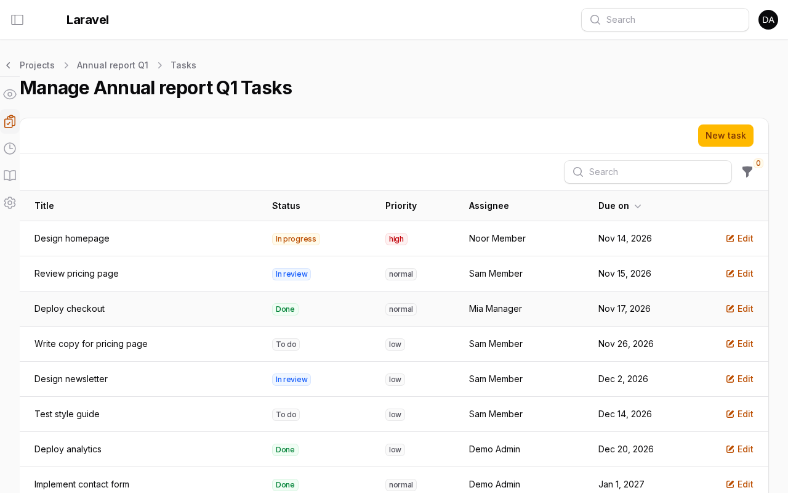
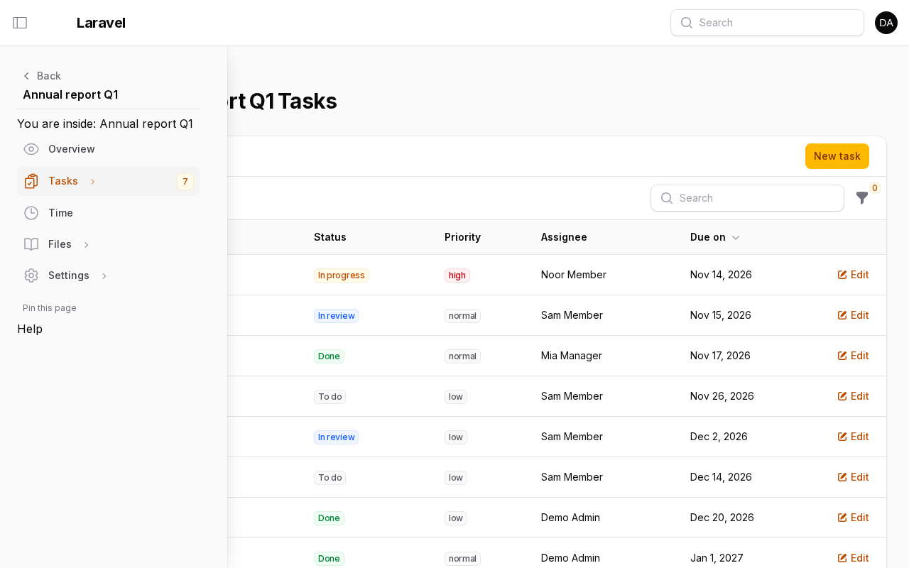
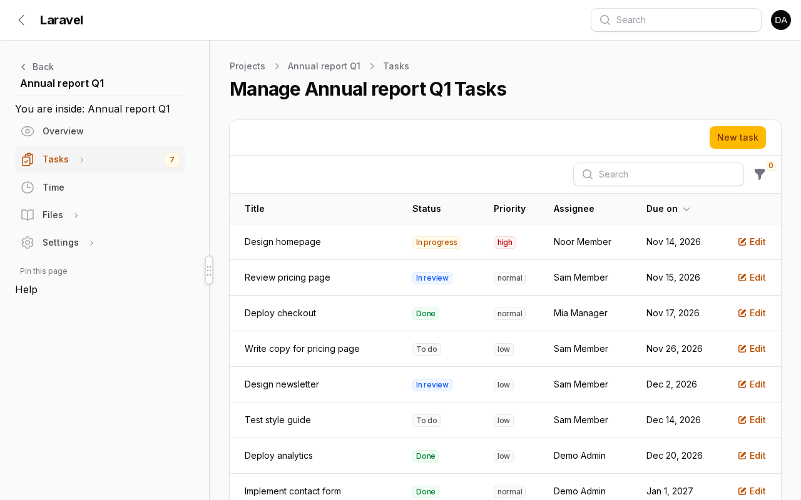
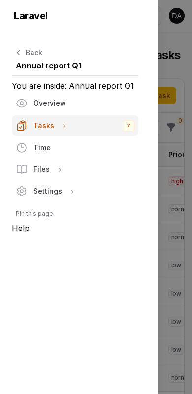
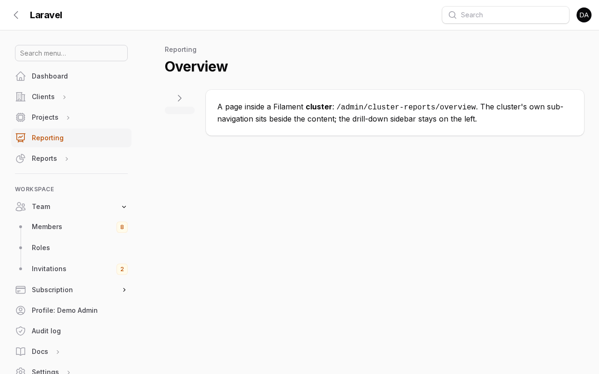

# Works with other Filament plugins

Checked on 2026-11-17 with Filament 5.11.4, in a scratch copy of our demo (`admin` panel, collapsible sidebar), with each plugin installed **alone** and then all together. For each one: the demo's 81 feature tests, plus a real browser (Chromium) run of the plugin's own feature next to the drill-down menu, with no JavaScript errors.

None of these plugins is a dependency of this package or of the demo.

| Plugin | Version | Result | Notes |
|---|---|---|---|
| [Hover Sidebar](https://github.com/vitisstudio/filament-hover-sidebar) (`vitisstudio/filament-hover-sidebar`) | 0.1.3 | ✅ works (since 0.6, see below) | At rest: our icons in its narrow rail. On hover: the full current level, title and Back. |
| [Sidebar Resize](https://github.com/Martin6363/filament-sidebar-resize) (`martin6363/filament-sidebar-resize`) | 1.0.1 | ✅ works | Dragging the handle widens the sidebar (200 → 335 px in the test); the width is kept when you drill into another level. |
| [Refresh Sidebar](https://github.com/jeffersongoncalves/filament-refresh-sidebar) (`jeffersongoncalves/filament-refresh-sidebar`) | 2.0.1 | ✅ works | Its `refresh-sidebar` event re-renders our menu on the **same level** (the level comes from the page URL, also on a Livewire re-render). |
| [Mobile Bottom Nav](https://github.com/hammadzafar05/mobile-bottom-nav) (`hammadzafar05/mobile-bottom-nav`) | 1.4.1 | ✅ works | Its bar shows Filament's own top-level items (we leave Filament's navigation intact). **More** opens the sidebar drawer with our menu on the current level. It does not know our per-record menus. To show our top-level pages in its bar, pass `DrilldownNavPlugin::current()?->flatten()` filtered to `depth === 0` to its `items()` (see the README). |
| [Collapsible Sub-Nav](https://github.com/Emuniq/filament-collapsible-subnav) (`emuniq/filament-collapsible-subnav`) | 1.6.0 | ✅ works | It collapses Filament's page/cluster sub-navigation beside the content; our sidebar is untouched. |
| Hover Sidebar **+** Sidebar Resize together | | ⚠️ they conflict with each other | Both set the sidebar's width. Not caused by this plugin; use one of them. |

| Hover rail at rest | Hover: full menu | Resized | Bottom nav → More | Collapsible Sub-Nav |
|---|---|---|---|---|
|  |  |  |  |  |

## Bug found and fixed while testing

Content added through this plugin's [render hooks](../README.md) (for example the demo's "You are inside: …" line) was not hidden in the collapsed (icon-only) sidebar. Free text then stretched the icon rail to about 250 px, with or without Hover Sidebar. Hook content is now wrapped in `.fi-drilldown-hook` and, in a panel with `->sidebarCollapsibleOnDesktop()`, shown only while the sidebar is open.

## Not checked

- Plugins that **replace** Filament's sidebar list (e.g. *Pinnable Navigation*, *Drilldown sidebar* by another author): they can't run next to this plugin, which replaces that list itself.
- Command palettes (*Spotlight* and similar).
- Hover Sidebar's rail is narrower with our menu (about 32 px of content) than you might expect; we did not compare it with Filament's own items under that plugin.

## How to repeat the check

1. Copy the repository, `cd demo`, `composer require` the plugin(s), and register them on the `admin` panel in `AdminPanelProvider` (Collapsible Sub-Nav registers itself).
2. `php artisan filament:assets && php artisan migrate:fresh --seed && php artisan test`.
3. `php artisan serve`, log in as `demo@example.com` / `password`, and try the plugin on `/admin/projects/1/tasks` (record menu) and `/admin/cluster-reports/overview` (cluster), on desktop and at 390 px wide.
