# The demo app

A realistic agency client portal that exercises every feature.

`demo/` is a Laravel 13 + Filament v5 app wired to the package via a path repository. It is a realistic back office, not a toy: about **3,000 rows** (12 clients, ~56 projects, ~760 tasks, ~225 documents, ~146 invoices, ~1,330 time entries) and **four roles**.

| Area | What it shows |
|---|---|
| **Clients** (staff only) | table → click a client → its own menu: Overview, **Projects** (opens a level listing that client's projects, with a count badge), **Invoices** (a nested resource, badge = unpaid invoices), Contacts |
| **Projects** | table → click a project → its menu: Overview, **Tasks** (nested resource, badge = open tasks), Time, Files → Documents / Links, Settings |
| **Tasks** | each task has its own menu (Details, Comments, History) under a custom header (`recordHeader()`: All tasks, title, status): **five levels**: Projects → Project → Tasks → Task → Comments |
| **Roles** | `admin`, `manager`, `member`, `client`: menus and pages differ (a client login sees only its own client's projects and never Clients, Time or Settings) |
| **Reports** | a group imported from native Filament navigation: sort order, group icon, badge, native parent item, permission-gated page |
| **Workspace** | click-to-expand sections with a heading and divider, nested expand, remembered state |
| Other panels | `portal` (second tree, inline by default), `plain` (no plugin), `workspace` (tenancy + domain) |

```bash
cd demo
composer install
cp .env.example .env && php artisan key:generate
touch database/database.sqlite && php artisan migrate --seed
php artisan serve
```

Log in at `/admin/login` (password `password`, local demo data only):

| Email | Role | Sees |
|---|---|---|
| `demo@example.com` | admin | everything, including *Audit log* and *Billing* |
| `manager@example.com` | manager | Clients, projects, invoices |
| `member@example.com` | member | projects and tasks |
| `client@example.com` | client (Acme Corp) | only Acme's projects; no Clients, Time or Settings |

| Client menu (real badges) | A client's projects, as a level |
|---|---|
| 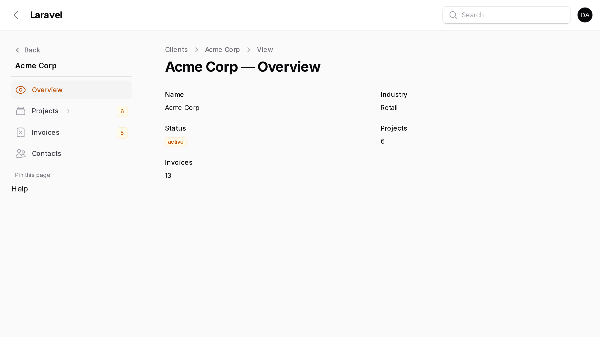 | 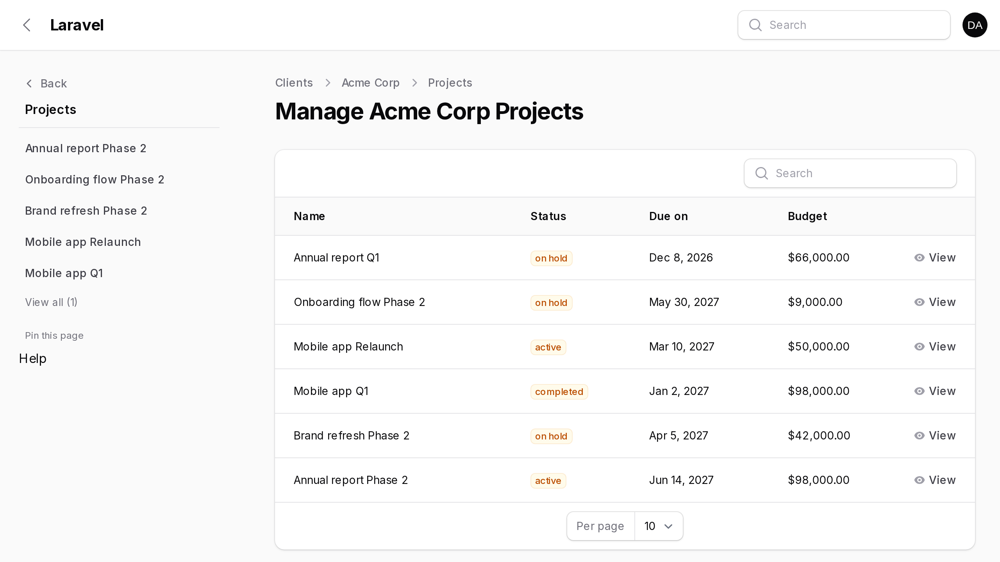 |
| **Project menu (open-task badge)** | **Level 4: one task, its own menu** |
| 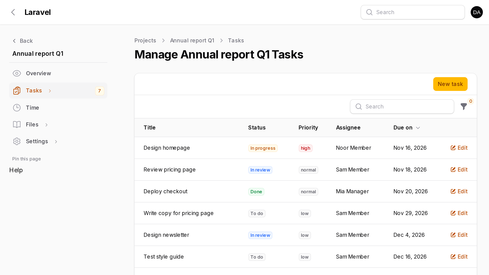 | 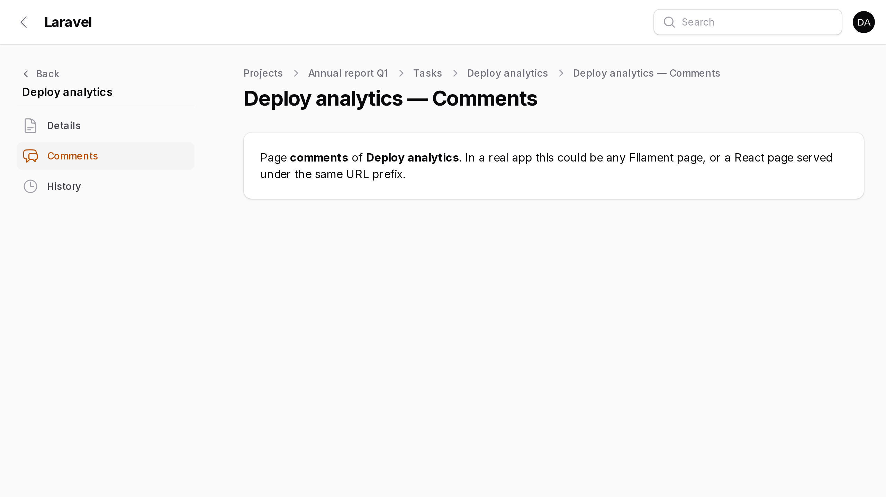 |
| **Same project as a client login** | **Staff top level** |
| 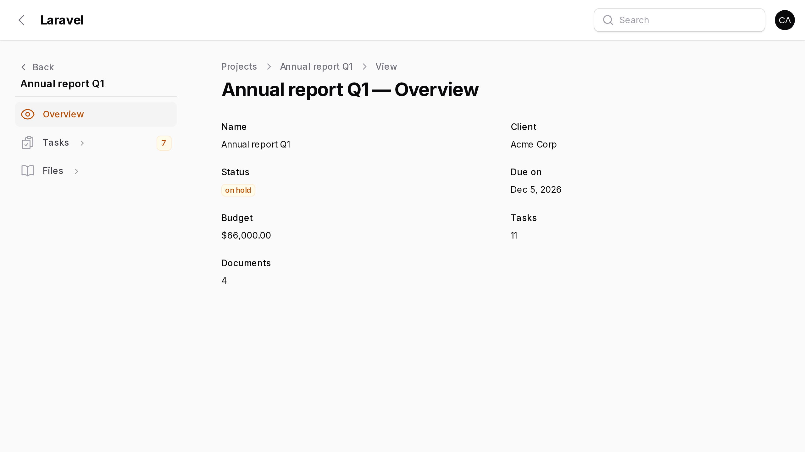 | 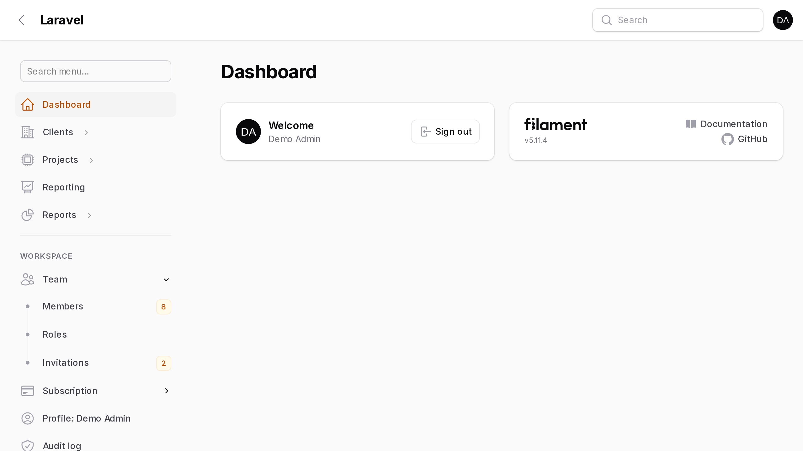 |

<details>
<summary>More screenshots</summary>

| Projects table | Nested resource inside a project |
|---|---|
| 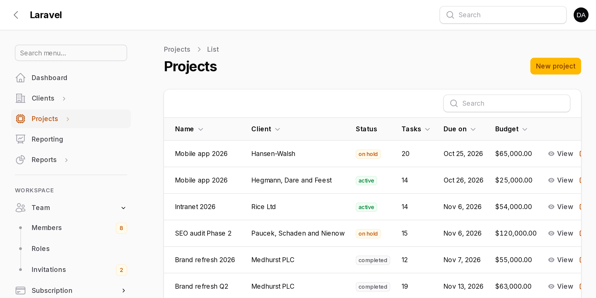 | 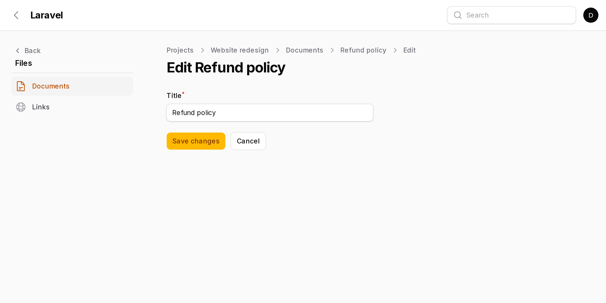 |

| Native parent item (Usage → By project) | Dark mode |
|---|---|
| 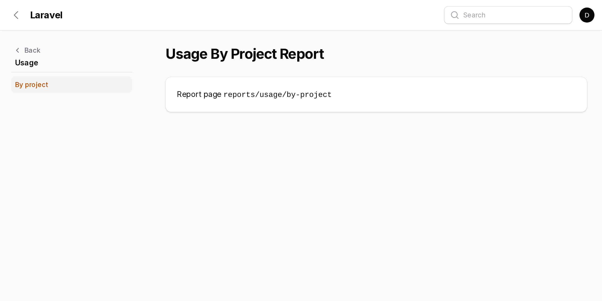 | 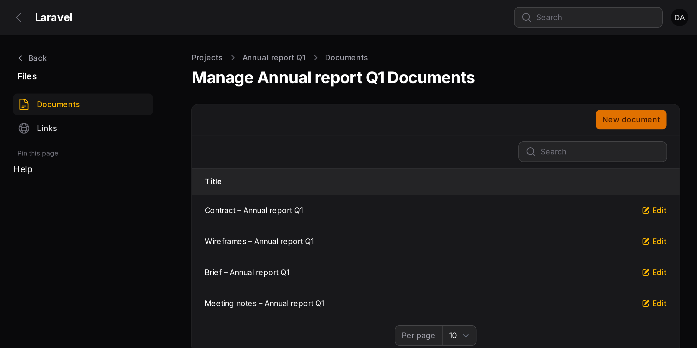 |

| Mobile drawer |
|---|
| 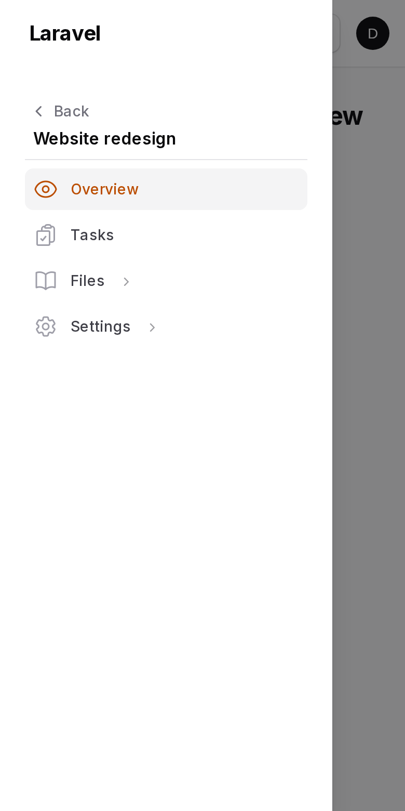 |

</details>
