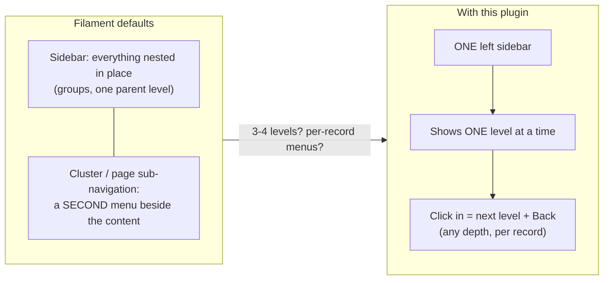
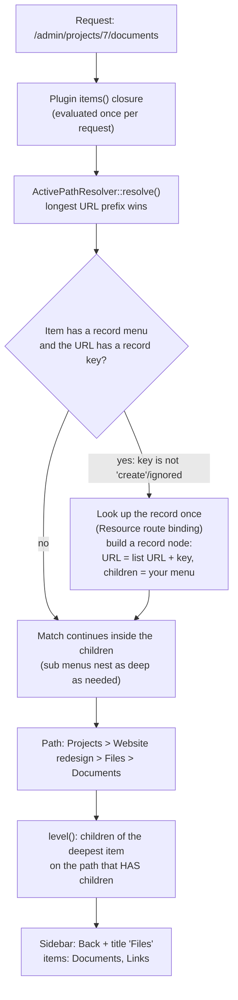
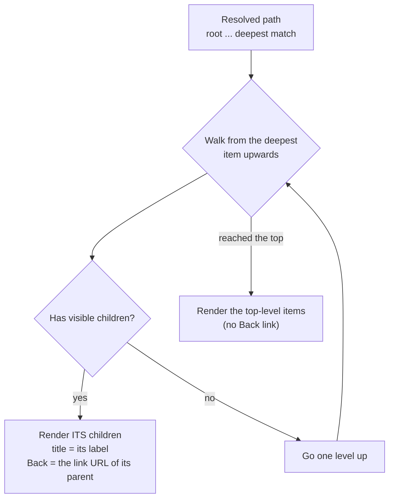
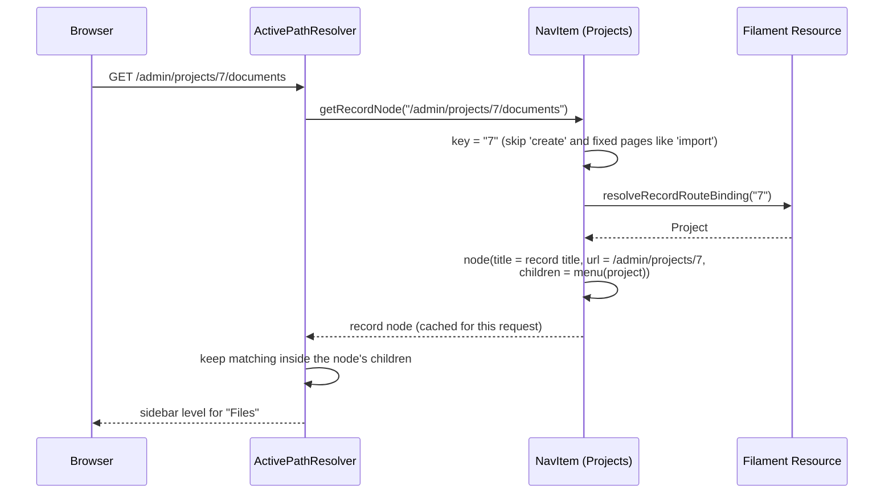
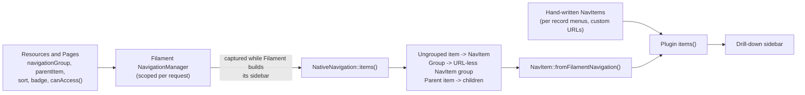
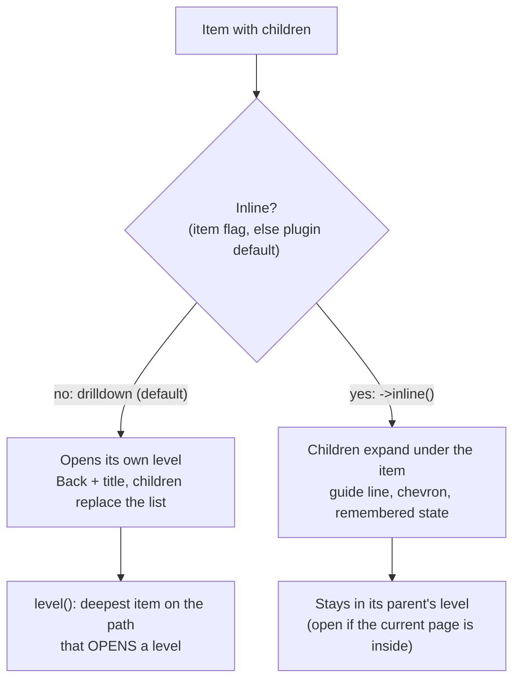
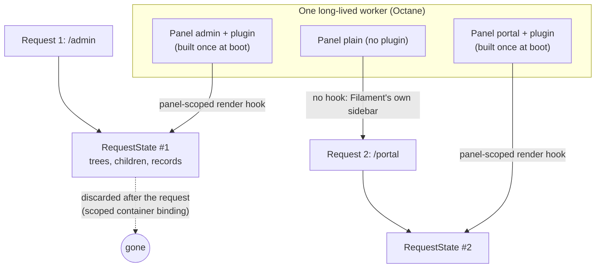
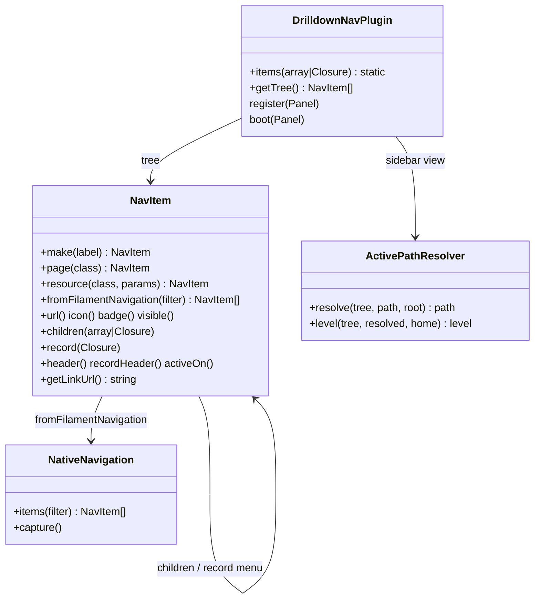

# How it works

This page explains **what problem the plugin solves**, **how a request turns into a sidebar**, and **how it reuses Filament's own navigation**. For usage, see the [README](../README.md).

## 1. The problem

Filament's sidebar shows the whole tree at once, and sub-navigation for one cluster or page sits *next to the content* as a second menu. That works for two levels. It breaks down when:

- an area has its own menu ("click an project → Tasks, Files, Settings");
- those items have sub menus (Files → Documents, Links), and you want 3–4 levels;
- you want the menu to stay in **one place** (the left sidebar), not split across two.

| You want | Filament alone | This plugin |
|---|---|---|
| Menu for one record (project, site, ...) | no (you build a custom sub-navigation per page) | `->record(fn ($record) => [...])` |
| 3–4 levels in the left sidebar | no (groups + one parent level) | yes, any depth |
| Keep existing Resources/Pages and their `$navigationGroup` etc. | n/a | `NavItem::fromFilamentNavigation()` |
| One menu location | no (sidebar + sub-navigation) | yes |

## 2. From request to sidebar

The plugin never stores "where the user is" in JavaScript. On **every request** the server works it out from the URL, so refreshes, deep links and shared links always land on the right level.

### Choosing the level

Rules worth knowing:

- **Longest prefix wins** (on a tie the deeper item wins). Only the *path* part of a URL is compared, so absolute URLs from `Resource::getUrl()` work.
- **The panel root URL and same-URL ancestors match exactly only** — otherwise Dashboard (`/admin`) would light up on every page, and a record's "Overview" (same URL as the record node) would always be active.
- **A URL-less item is a group.** Clicking it goes to its first reachable child.
- **Unknown URLs** show the top level with nothing highlighted.
- **Closures run once per request**, and only for items on the current path (children of other items are never opened).

## 3. A menu per record

`NavItem::resource(ProjectResource::class)->record(fn (Project $project) => [...])` makes the record menu one more level of the same tree:

A failing lookup (for example a non-numeric key on a PostgreSQL integer column) is treated as "no such record", so such URLs fall back to the top level instead of erroring.

The record node takes its header from `recordHeader()`, called with the record when that level is rendered; without one, the level shows Back and the record title. Separately, `activeOn()` gives any item extra URLs: the resolver tries the item's own URL and these the same way (prefix, or exact only for the panel root and ancestor URLs), and the longest match counts. So a list at `/agents/5/sources` can stay current on `/agents/5/knowledge/9/edit`.

## 4. Reusing Filament's navigation

Everything you already declare the Filament way keeps working: `$navigationGroup`, `$navigationParentItem`, `$navigationSort`, `$navigationBadge`, `shouldRegisterNavigation()`, `canAccess()`, `NavigationItem::make()`.

Why it is done this way: Resources and Pages only register their navigation items while Filament is *building* its sidebar. The plugin's navigation builder therefore captures the items at that moment (into a fresh `NavigationManager`, so Filament's own one is never mounted twice). Use the optional `$filter` to drop items you list by hand.

## 5. Two ways to show children

- **Which level is shown** is decided by `opensLevel()`: an item with children that is *not* inline. Inline items never create a level, so a page inside an inline section keeps the sidebar on the level that contains the section, with the section open and the current page marked.
- **Open or closed:** open when the current page is inside it, otherwise the stored choice (the `fi-drilldown-open` cookie, read on the server so the first paint is right), otherwise `defaultExpanded()`. With `accordion()`, only sections on the current path start open, and opening one closes its siblings.
- **Collapsed sidebar** (`sidebarCollapsibleOnDesktop()`): text, titles, headings and badges are bound to Filament's `$store.sidebar.isOpen`, so only icons remain; items reuse Filament's own tooltips; clicking an expandable row opens the sidebar instead of toggling hidden children.
- **Headings and dividers** are items without URL or children, so they never take part in URL matching.

## 6. Several panels, long-lived workers, tenants

- **Per request, not per worker.** The evaluated item tree, children closures, record lookups and the native-navigation capture live in `RequestState`, a *scoped* container binding: Laravel (and Octane) drop it after every request. The plugin object, panel and any `NavItem` you built outside a closure stay alive for the whole worker, so nothing request-specific is stored on them. This is why one request can never see another's record titles or children.
- **Panel-scoped hook.** The sidebar is rendered by a hook registered on the panel itself (not globally) and only when that panel is the one being shown. Two panels can use the plugin with different trees, and a panel without the plugin keeps Filament's own sidebar.
- **Tenants and domains.** Home, Back-to-root and the "exact match" rule use the URL Filament itself builds for the panel (`Panel::getUrl($tenant)`): domain, path and tenant included. The request path includes the application's base path, so sub-directory installs match too.
- **Languages.** The two strings the plugin owns ("Back" and the landmark label) are translated in English, Simplified/Traditional Chinese (`zh_CN`, `zh_TW`, `zh_HK`), Japanese, Korean, Spanish and the right-to-left languages Arabic, Hebrew, Persian and Urdu, and can be overridden by publishing the translations. Your own labels are yours to translate.

## 7. What is in the box

| File | Responsibility |
|---|---|
| `src/DrilldownNavPlugin.php` | Registers the plugin: swaps in `DrilldownSidebar`, hides Filament's default list in the sidebar only (navigation stays intact elsewhere) and renders ours at `SIDEBAR_NAV_START`. |
| `src/Livewire/DrilldownSidebar.php`, `Concerns/HidesNativeNavigation.php` | Filament's sidebar component, with its native list hidden while it renders. |
| `src/Tree/NavItem.php` | The menu item: label, icon, URL, extra active URLs, badge, visibility, children (drilldown or inline), headings, dividers, per-record menu, custom level header. |
| `src/ChildDisplay.php` | Enum: `Drilldown` or `Inline` default for a panel. |
| `src/Tree/ActivePathResolver.php` | Pure logic: request path → active path → level to render. No Filament or HTTP dependencies, so it is easy to test. |
| `src/RequestState.php` | Per-request memo (scoped binding): item tree, children, record nodes, native capture. |
| `src/Tree/NativeNavigation.php` | Adapter from Filament's navigation to `NavItem`s. |
| `resources/views/sidebar.blade.php` | Renders Back and title (or a custom header), and items (reusing `x-filament-panels::sidebar.item`), plus the slide animation. |

## 8. Limits

- Items without an icon show nothing in the collapsed (icon-only) sidebar: give top-level items an icon.
- Right-to-left: supported and checked in a browser with Arabic (mirrored chevrons, Back arrow and animation); Hebrew, Persian and Urdu use the same rules and ship the plugin's strings (machine-written; native-speaker review welcome).
- The plugin owns the sidebar list: items you do not list (or import with `fromFilamentNavigation()`) are not shown.
- Right-to-left languages: strings and `dir` are fine, but the slide animation and chevrons are not mirrored yet.
- The level is derived from the URL. A record menu therefore needs its URLs to live under the resource's own URL (`/admin/projects/{record}/...`).
