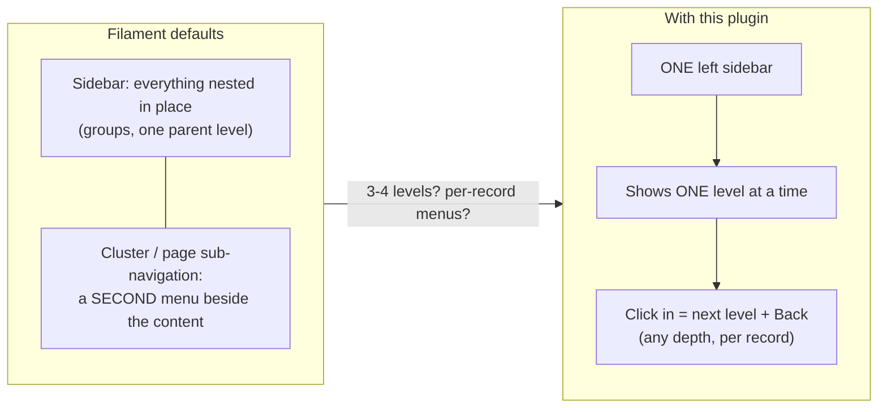
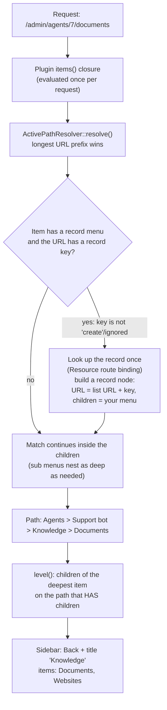
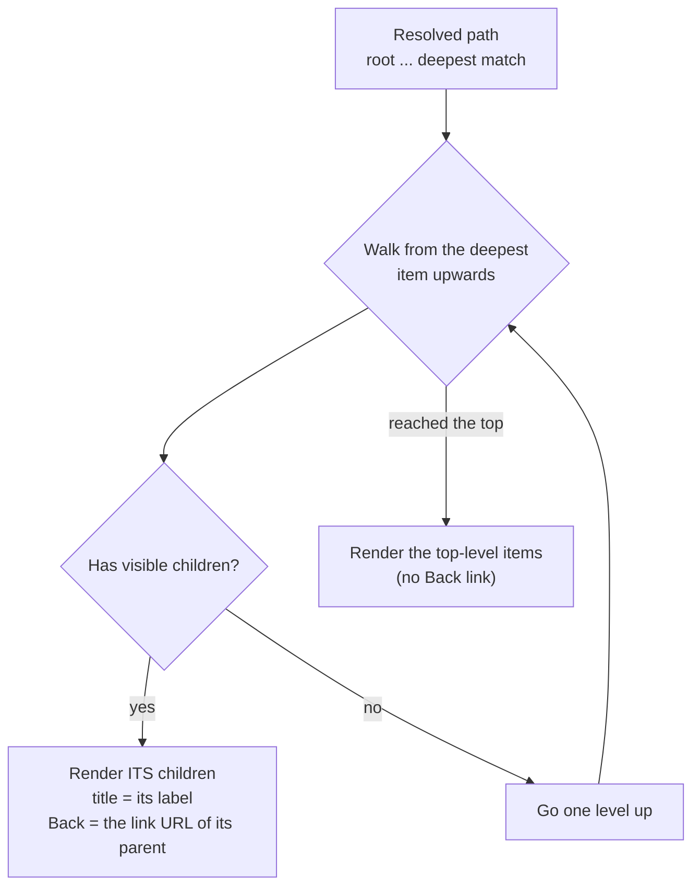
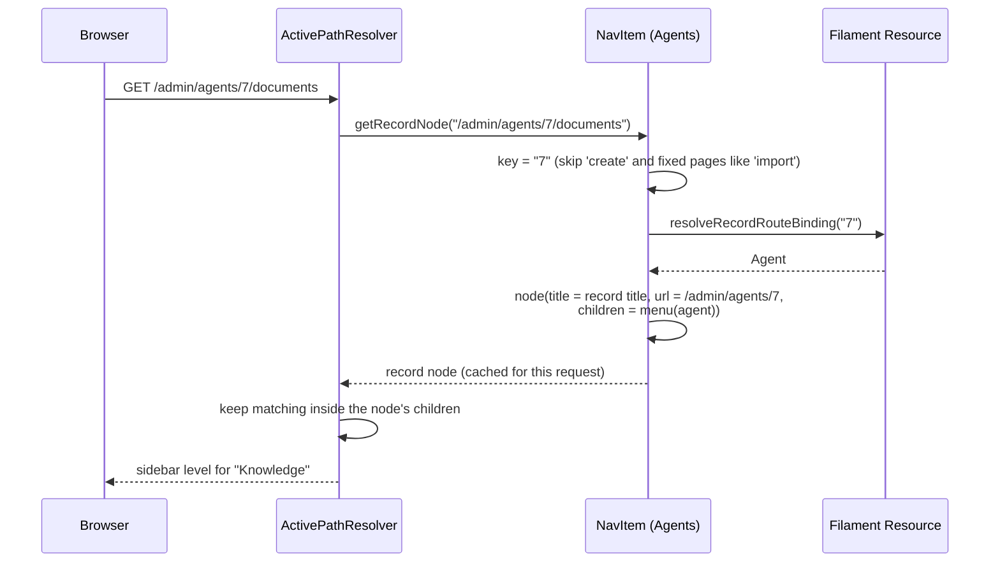
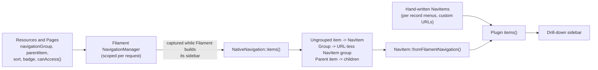
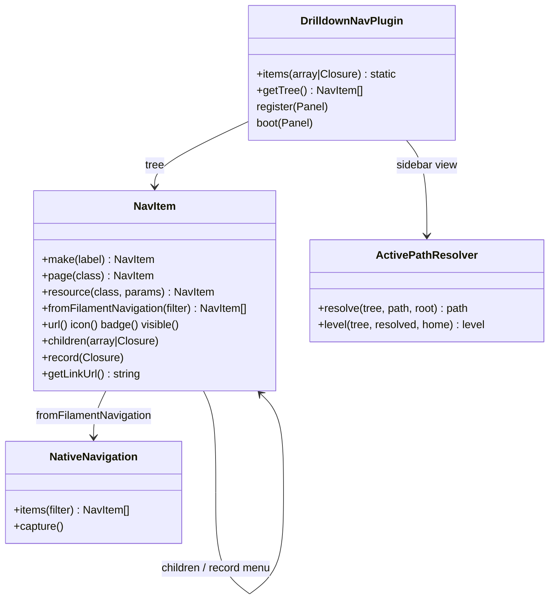

# How it works

This page explains **what problem the plugin solves**, **how a request turns into a sidebar**, and **how it reuses Filament's own navigation**. For usage, see the [README](../README.md).

## 1. The problem

Filament's sidebar shows the whole tree at once, and sub-navigation for one cluster or page sits *next to the content* as a second menu. That works for two levels. It breaks down when:

- an area has its own menu ("click an agent → Playground, Knowledge, Settings");
- those items have sub menus (Knowledge → Documents, Websites), and you want 3–4 levels;
- you want the menu to stay in **one place** (the left sidebar), not split across two.

| You want | Filament alone | This plugin |
|---|---|---|
| Menu for one record (agent, site, ...) | no (you build a custom sub-navigation per page) | `->record(fn ($record) => [...])` |
| 3–4 levels in the left sidebar | no (groups + one parent level) | yes, any depth |
| Keep existing Resources/Pages and their `$navigationGroup` etc. | n/a | `NavItem::fromFilamentNavigation()` |
| One menu location | no (sidebar + sub-navigation) | yes |

## 2. From request to sidebar

The plugin never stores "where the user is" in JavaScript. On **every request** the server works it out from the URL, so refreshes, deep links and shared links always land on the right level.

### Choosing the level

Rules worth knowing:

- **Longest prefix wins** (on a tie the deeper item wins). Only the *path* part of a URL is compared, so absolute URLs from `Resource::getUrl()` work.
- **The panel root URL and same-URL ancestors match exactly only** — otherwise Dashboard (`/admin`) would light up on every page, and a record's "Overview" (same URL as the record node) would always be active.
- **A URL-less item is a group.** Clicking it goes to its first reachable child.
- **Unknown URLs** show the top level with nothing highlighted.
- **Closures run once per request**, and only for items on the current path (children of other items are never opened).

## 3. A menu per record

`NavItem::resource(AgentResource::class)->record(fn (Agent $agent) => [...])` makes the record menu one more level of the same tree:

A failing lookup (for example a non-numeric key on a PostgreSQL integer column) is treated as "no such record", so such URLs fall back to the top level instead of erroring.

## 4. Reusing Filament's navigation

Everything you already declare the Filament way keeps working: `$navigationGroup`, `$navigationParentItem`, `$navigationSort`, `$navigationBadge`, `shouldRegisterNavigation()`, `canAccess()`, `NavigationItem::make()`.

Why it is done this way: Resources and Pages only register their navigation items while Filament is *building* its sidebar. The plugin's navigation builder (which keeps the sidebar shell alive while emptying the default list) therefore captures the items at that moment, using Filament's public `NavigationManager` API. Use the optional `$filter` to drop items you list by hand.

## 5. What is in the box

| File | Responsibility |
|---|---|
| `src/DrilldownNavPlugin.php` | Registers the plugin: empties Filament's default list (keeps the sidebar shell) and renders ours at `SIDEBAR_NAV_START`. |
| `src/Tree/NavItem.php` | The menu item: label, icon, URL, badge, visibility, children, per-record menu. |
| `src/Tree/ActivePathResolver.php` | Pure logic: request path → active path → level to render. No Filament or HTTP dependencies, so it is easy to test. |
| `src/Tree/NativeNavigation.php` | Adapter from Filament's navigation to `NavItem`s. |
| `resources/views/sidebar.blade.php` | Renders Back, title and items (reusing `x-filament-panels::sidebar.item`), plus the slide animation. |

## 6. Limits

- Collapsed (icon-only) sidebar mode is not specially handled yet.
- The plugin owns the sidebar list: items you do not list (or import with `fromFilamentNavigation()`) are not shown.
- The level is derived from the URL. A record menu therefore needs its URLs to live under the resource's own URL (`/admin/agents/{record}/...`).
