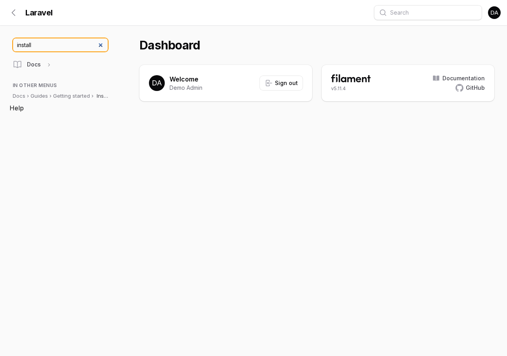
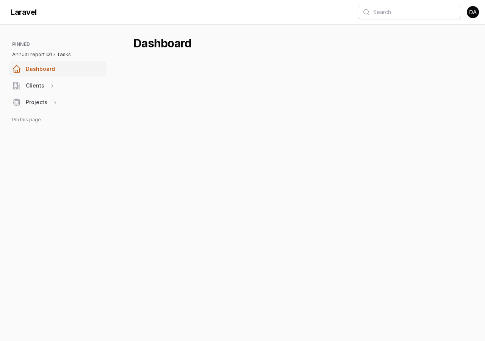
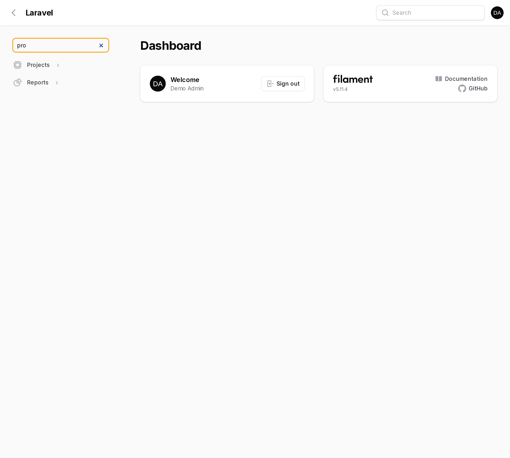
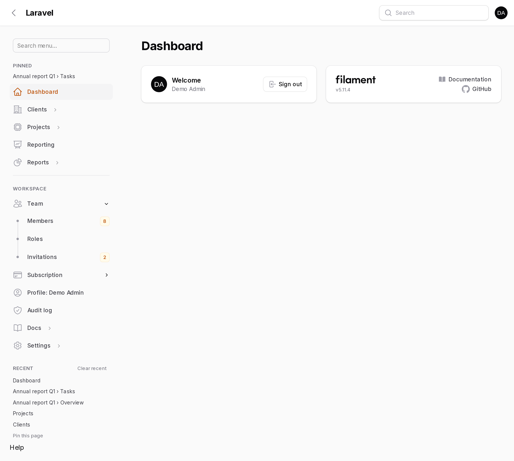

# Large menus

Search, shortcuts, recent and pinned pages, long lists, live badges.

```php
DrilldownNavPlugin::make()
    ->searchable(minItems: 6, allLevels: true)   // a filter box once a level lists 6+ items, also finding pages on other levels; '/' focuses it
    ->recent(5)                 // the last 5 pages visited, at the top level
    ->pinnable()                // "Pin this page" + a Pinned list
    ->items(fn () => [
        NavItem::make('Projects')->url('/admin/clients/1/projects')
            ->children(fn () => $client->projects()->limit(40)->get()->map(fn ($p) => NavItem::make($p->name)->url(…))->all())
            ->limit(5, '/admin/clients/1/projects'),   // show 5, then "View all (N)"
    ]);
```

- **Search** filters what is already on screen (the current level and inline sections) as you type: a section stays visible when a child matches, headings hide, `Esc` clears, and a note appears when nothing matches. With `allLevels: true` it also lists matching pages from levels you have not opened, under **In other menus**, with their trail ("Docs › Guides › Getting started › Install"). That index is the whole menu as the user may see it (`flatten()`, below), loaded once over Livewire the first time someone types two letters; it runs `children()` closures, stops after 300 pages, and leaves out per-record menus (records are not enumerated). Press **`/`** anywhere on the page (outside a text field) to focus the box; change or turn off the key with `searchable(shortcut: 'k')` / `shortcut: null`.

  

- **The menu as a list:** `DrilldownNavPlugin::current()?->flatten()` returns every page the current user may see as `['label', 'url', 'trail', 'depth']`, for a command palette, tests, or a mobile bottom bar:

  ```php
  // e.g. Mobile Bottom Nav, with our top-level pages
  MobileBottomNav::make()->items(fn () => collect(DrilldownNavPlugin::current()?->flatten() ?? [])
      ->where('depth', 0)->take(4)
      ->map(fn (array $page) => MobileBottomNavItem::make($page['label'])->url($page['url']))->all());
  ```
- **Pinned pages in the database:** `->pinnable(database: true)` stores pins in a `drilldown_nav_pins` table per user, panel and tenant, so they follow the user to every device and are rendered by the server (no empty list until JavaScript runs). Publish and run the migration once: `php artisan vendor:publish --tag=filament-drilldown-nav-migrations && php artisan migrate`. Use your own model on the same table with `pinnable(database: true, model: MyPin::class)` (it must extend `SolutionForest\DrilldownNav\Models\DrilldownPin`). Only paths under the panel (and tenant) can be pinned; at most 20 per user; the label of a pinned page is updated when the user visits it. The **Pinned** list sits at the top of the top level. (Demo: the `auto` panel.)

  
- **Recent / Pinned** *(experimental, may change before 1.0)* are otherwise stored in the browser per panel, tenant and user, show at the top level, and remember the page's trail (e.g. "Website redesign › Tasks"). The pin toggle appears on every level. Only entries under the current panel (and tenant) URL are shown. They are links, not permissions: a pinned page the user can no longer open still shows until it is unpinned, and opening it gets Filament's usual 403/404.
- **`->limit($max, $moreUrl)`** shortens the **display** of a long child list; it does not make big menus cheaper. All children still take part in URL matching and the child containing the current page is never hidden, so the sidebar stays correct. Keep your own query small (`limit()` on the query): it shortens the display, it does not avoid loading the rows.

| Search | Pinned + Recent |
|---|---|
|  |  |
