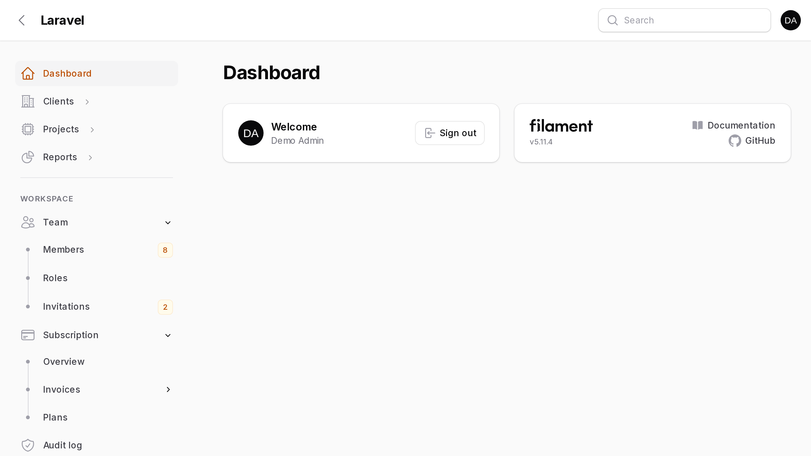
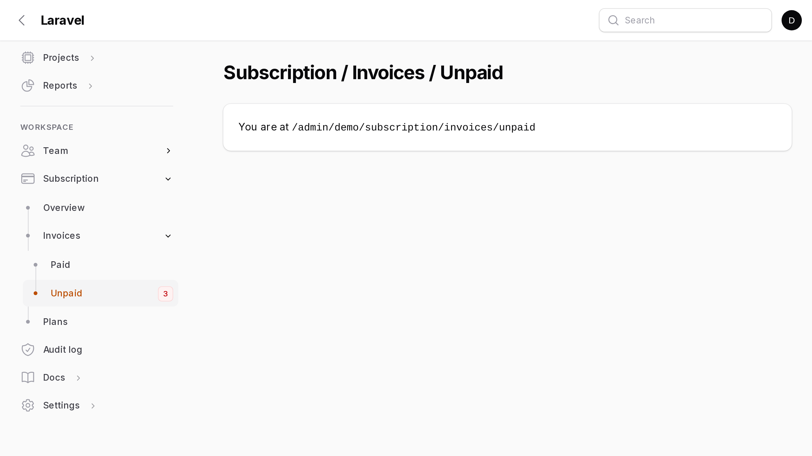
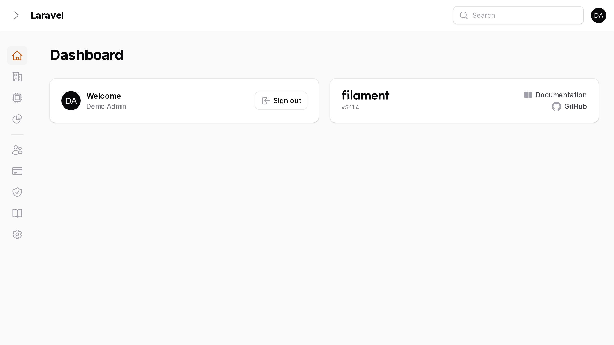
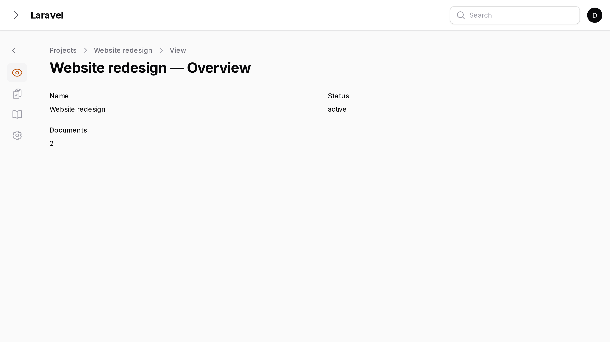

# Modern navigation

Expand in place, lines and icons, headings, the collapsed sidebar and accessibility.

Besides drilling into a new level, an item's children can **expand in place**, like a classic tree:

```php
NavItem::heading('Workspace')->divider(),                       // section heading + a line above it

NavItem::make('Team')->icon('heroicon-o-users')
    ->inline()                                                  // children expand under the item
    ->defaultExpanded()                                         // start open (otherwise: closed, remembered)
// DrilldownNavPlugin::make()->accordion()                      // only one section open at a time
    ->children([
        NavItem::make('Members')->url('/admin/team/members')->badge('8'),
        NavItem::make('Invitations')->url('/admin/team/invitations')->badge('2', 'warning'),
    ]),

NavItem::make('Subscription')->icon('heroicon-o-credit-card')->inline()->children([   // nesting works
    NavItem::make('Overview')->url('/admin/subscription'),
    NavItem::make('Invoices')->inline()->children([ /* ... */ ]),
]),
```

| | |
|---|---|
| `->inline()` / `->drilldown()` | per item: expand in place, or open a new level (the default) |
| `DrilldownNavPlugin::make()->childDisplay(ChildDisplay::Inline)` | change the default for the whole panel (items can still override) |
| `->defaultExpanded()` | inline items start open; otherwise the open/closed state is remembered per browser |
| `DrilldownNavPlugin::accordion()` | only one inline section open at a time within the same parent; opening one closes its siblings |
| `NavItem::heading('…')`, `->divider()` | non-clickable section headings and separator lines |
| `->icon()`, `->activeIcon()`, `->badge()` | icons (outline/solid when current) and badges; icon-less nested items get Filament's guide line and dot |

What you get without extra code: the section containing the current page is **open** and its parents marked; guide lines for nested items (Filament's own style); chevrons that rotate; state remembered across page loads **and rendered by the server** (a `fi-drilldown-open` cookie, so a closed section never flashes open on load); **collapsed (icon-only) sidebar** when the panel uses `->sidebarCollapsibleOnDesktop()` (labels, titles and badges hide, Back keeps its arrow with a tooltip, tooltips on items); keyboard-operable toggle buttons with `aria-expanded`; `aria-current="page"` on the current item; a labelled `nav` landmark; focus moves to the new level's title when you drill in or out; `prefers-reduced-motion` respected; and mirrored chevrons, Back arrow and animation for right-to-left pages (checked with Arabic).

| Expand in place (`->inline()`) | Nested, with guide lines |
|---|---|
|  |  |

| Collapsed: top level | Collapsed: inside a project |
|---|---|
|  |  |

In the collapsed sidebar, a top-level item without an icon shows its **initial** in a small square, so it stays visible and clickable (with the label as tooltip). Icons still read better: give top-level items an icon where you can.
