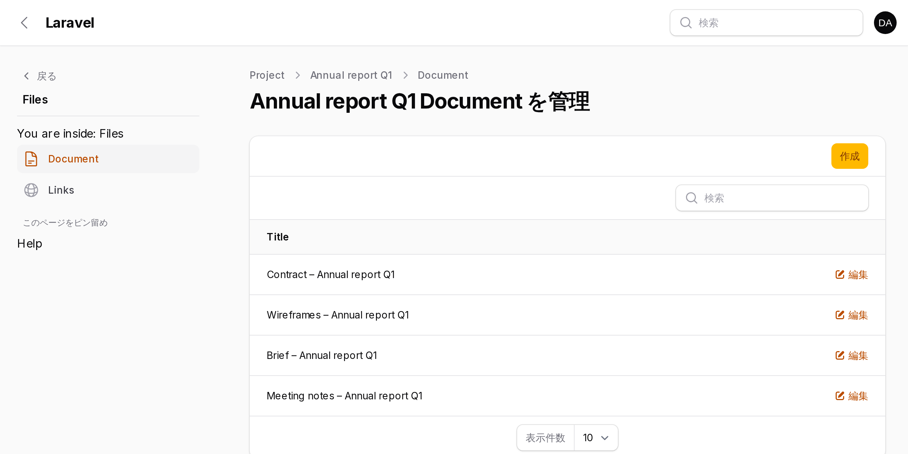
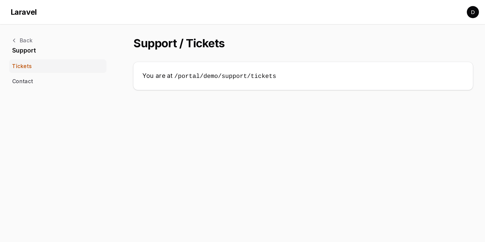
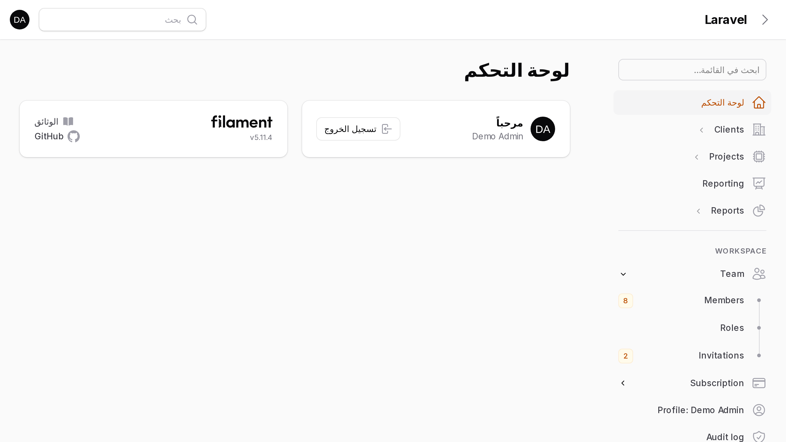
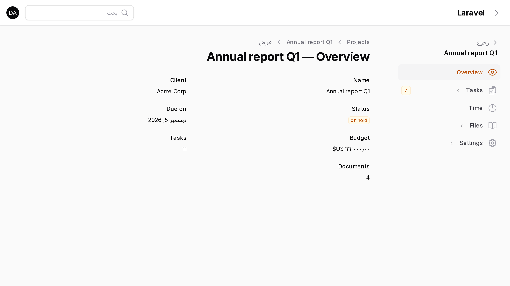

# Panels, workers, tenants and languages

Several panels, long-lived workers (Octane), tenancy and domains, translations and right-to-left.

## Several panels

Register the plugin on as many panels as you like, each with **its own tree**. A panel without the plugin keeps Filament's own sidebar untouched.

```php
// AdminPanelProvider
$panel->plugin(DrilldownNavPlugin::make()->items(fn () => [/* admin menu */]));

// PortalPanelProvider: a different tree, inline children by default
$panel->plugin(DrilldownNavPlugin::make()->childDisplay(ChildDisplay::Inline)->items(fn () => [/* portal menu */]));
```

The sidebar is rendered by a hook registered on the panel itself and only when that panel is the one being shown, so panels never see each other's menus. (Demo: `admin`, `portal` and `plain`, a panel without the plugin.)

## Octane and other long-lived workers

The package is built for workers that serve many requests: everything request-specific (the evaluated item tree, children, record lookups) lives in a **request-scoped container binding** that Laravel and Octane discard after each request. Nothing request-specific is stored on the plugin or on a `NavItem`.

**One rule for your code: pass a closure to `items()`.**

```php
->items(fn () => [ /* may use auth()->user(), the tenant, the database */ ])
```

The closure runs once per request. A `NavItem` you build *outside* a closure lives as long as the worker, which is fine for a static menu and wrong for anything that depends on the user.

How this is checked: the tests serve several requests with one application, and `demo/bin/octane-smoke.sh <roadrunner|swoole|frankenphp>` starts a **real Octane server**. Phase 1 uses one worker and sequential requests (the strictest case for state leaking); phase 2 uses four workers and 300 parallel requests from two users across three panels, and every response must belong to its own user and panel. CI runs it for all three servers. You can run it against your own app's checks as a model: see `demo/bin/octane-smoke.php`.

## Tenancy and domains

Home, "Back to the top" and the "exact match" rule use the URL Filament itself builds (`Panel::getUrl($tenant)`), so `https://app.test/admin/{tenant}` and panels on their own domain work, and so do apps installed in a sub-directory. Build your own item URLs with Filament (`Page::getUrl()`, `Resource::getUrl()`), which are tenant-aware, instead of hard-coding `/admin/...`. (Demo: the `workspace` panel with tenancy on `workspace.localhost`.)

Recent and pinned pages are kept per panel and per tenant, so a page pinned in one tenant never shows in another.

## Languages and right to left

The plugin's own text ("Back", the navigation landmark, search, pin, …) is translated in **11 languages**: English, 简体中文, 繁體中文 (`zh_TW`, `zh_HK`), 日本語, 한국어, Español, and the right-to-left languages العربية, עברית, فارسی and اردو.

- Publish the texts to change them: `php artisan vendor:publish --tag=filament-drilldown-nav-translations`.
- Labels of **your own items** are yours to translate (use `__()` in the closure).
- With an RTL locale, chevrons, the Back arrow and the slide animation mirror. Arabic was checked in a browser; Hebrew, Persian and Urdu share the same rules, and their strings are machine-written, so a native-speaker review is welcome.

| Japanese UI | Second panel with its own tree |
|---|---|
|  |  |
| **Arabic (right-to-left): top level** | **Arabic: inside a project** |
|  |  |
