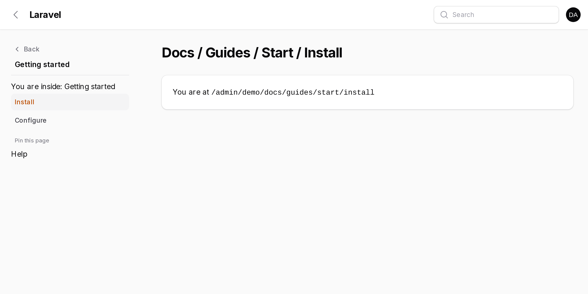
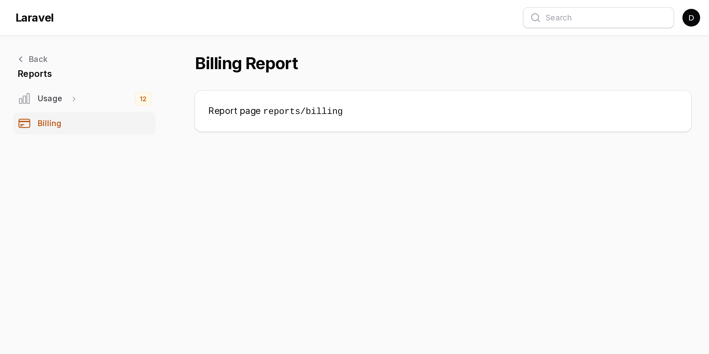
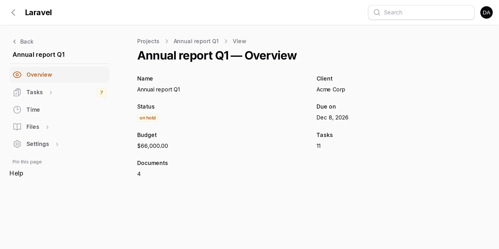
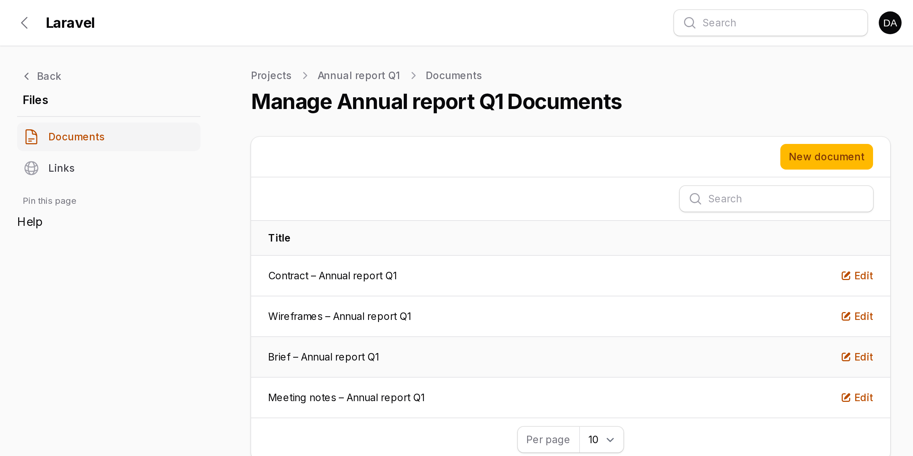
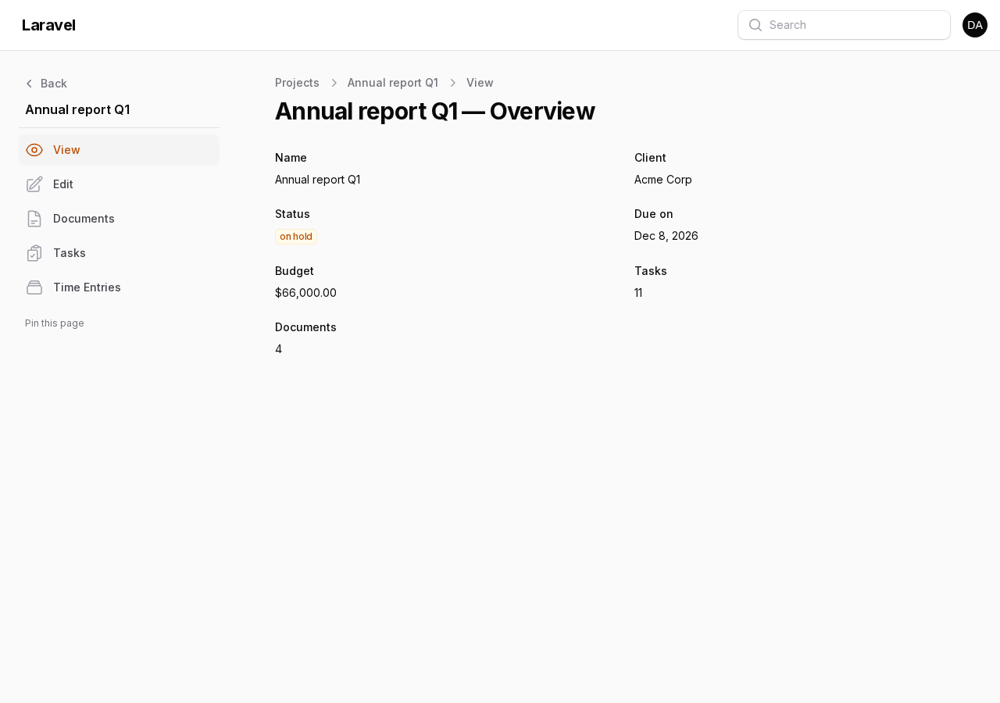

# Usage guide

Everything you write in `items()`: pages, resources, nested levels, record menus, native navigation, visibility and badges.

## 1. Pages, resources and plain URLs

```php
NavItem::page(Dashboard::class);                 // Filament Page
NavItem::resource(SiteResource::class);          // Filament Resource (list URL)
NavItem::make('Reports')->icon('heroicon-o-chart-bar')->url('/admin/reports')->badge('3', 'danger'); // any URL, e.g. a React page
```

## 2. Nested levels

```php
NavItem::make('Docs')->url('/admin/docs')->children([
    NavItem::make('Guides')->url('/admin/docs/guides')->children([
        NavItem::make('Install')->url('/admin/docs/guides/install'),
    ]),
]);
```

An item with children opens its own level when you visit its URL. An item **without a URL** is a pure group: clicking it goes to its first child.

| Level 4 | Reports (native group, badge) |
|---|---|
|  |  |

## 3. A menu per record

`record()` is the feature this plugin exists for. When the URL is `<list URL>/<key>/…` (and the key is not `create`), the key is resolved with the resource's own route binding and the sidebar shows your menu, titled with the record's title. Back returns to the list.

```php
NavItem::resource(ProjectResource::class)->record(fn (Project $project) => [ /* any NavItems, any depth */ ]);
```

| One project's menu | Sub menu inside it |
|---|---|
|  |  |

Record-menu URLs must live under the resource's own URL (`/admin/projects/{record}/…`), because that is how the plugin knows you are inside the record. Register extra pages on the resource, **after** `edit`:

```php
'edit' => EditProject::route('/{record}/edit'),
'section' => ProjectSection::route('/{record}/{section}'),
```

### Less code: a menu from the resource's own pages

Two shortcuts, so a record menu does not have to be written by hand:

```php
// 1. Build it from the resource's record pages: View, Edit, Manage… related records, custom /{record}/… pages.
//    Labels, icons, badges and access come from each page (getNavigationLabel(), canAccess() …),
//    exactly as Filament builds a record's sub-navigation. Pass page classes to choose and order them.
NavItem::resource(ProjectResource::class)->recordPages();
NavItem::resource(ProjectResource::class)->recordPages([ViewProject::class, ManageProjectTasks::class]);

// 2. Or let the resource declare its menu itself, next to its pages; NavItem::resource() then needs nothing else.
class ClientResource extends Resource implements \SolutionForest\DrilldownNav\Contracts\HasDrilldownRecordMenu
{
    public static function drilldownRecordMenu(Model $record): array
    {
        return [NavItem::make('Overview')->url(static::getUrl('view', ['record' => $record])), /* … */];
    }
}
```

`recordPages()` leaves out pages whose route needs more than the record (like `/{record}/{section}`). An explicit `->record()` or `->recordPages()` on the item wins over the resource's own menu. (Demo: the `auto` panel at `/auto`.)



For a non-resource item use `->resolveRecordUsing(fn (string $key) => …)` and `->recordTitleUsing(fn ($record) => …)`. Fixed pages below the list URL (like `/projects/import`) are never mistaken for a record: they are excluded automatically for `resource()`, or with `->ignoreRecordKeys(['create', 'import'])`.

### Your own header for a level

A level normally starts with **Back** and its title. Replace that with your own view, for example a card with the record's status and a switcher, with `->recordHeader()` (for a record's menu) or `->header()` (for any item that opens a level):

```php
NavItem::resource(TaskResource::class, ['project' => $project])
    ->recordHeader(fn (Task $task) => view('filament.nav.task-header', [
        'task' => $task,
        'backUrl' => TaskResource::getIndexUrl(['project' => $project]),
    ]))
    ->record(fn (Task $task) => [ /* ... */ ]);
```

A view (any `Htmlable`) is rendered as HTML, a string as escaped text, and `null` keeps the default. The header replaces Back too, so include a link back yourself. It receives keyboard focus when you drill in or out, like the default title. In the collapsed sidebar it is shown as you wrote it, so hide what does not fit with `x-show="$store.sidebar.isOpen"`. (Demo: one task's menu.)

### Pages that live elsewhere

An item is current when the URL starts with its own URL. When some of its pages live under another URL, list those with `->activeOn()`; they match the same way:

```php
NavItem::make('Files')
    ->url(ProjectResource::getUrl('files', ['record' => $project]))                // /projects/5/files
    ->activeOn([DocumentResource::getIndexUrl(['project' => $project])]);          // /projects/5/documents/{id}, …/create
```

When the URL cannot place a page at all (a shared route, a tab in the query string, a React route), use `->activeWhen()` with any condition:

```php
NavItem::make('Exports')->url('/admin/reports/exports')
    ->activeWhen(fn (): bool => request()->routeIs('downloads.*'));
```

It counts as an exact URL match (if another item matches the URL exactly, the deeper one wins) and runs at most once per request. It is found inside branches given as arrays; children built by a closure are only opened on the current path, so put `activeWhen()` items there only if their parent also matches.

## 4. Reuse Filament's own navigation

Anything you already declare the Filament way keeps working (`$navigationGroup`, `$navigationParentItem`, `$navigationSort`, `$navigationBadge`, `shouldRegisterNavigation()`, `canAccess()`, `NavigationItem::make()`):

```php
...NavItem::fromFilamentNavigation(
    fn (NavigationItem $item): bool => $item->getUrl() !== Dashboard::getUrl() // leave out what you list by hand
)
```

Groups become URL-less groups (with the group icon you registered on the panel), parent items become sub levels, badges and access checks carry over. See the *Reports* group in the demo.

## 5. Visibility and badges

```php
NavItem::make('Billing')->visible(fn () => auth()->user()->isAdmin());
NavItem::make('Inbox')->badge(fn () => (string) Message::unread()->count(), 'danger');
```

Empty groups disappear. Closures run once per request, and only for items on the current path.

**Live updates.** The sidebar is a Livewire component, so it can refresh without a page load, on the same level:

```php
DrilldownNavPlugin::make()->pollBadges('30s');   // re-render every 30 s (paused by Livewire in background tabs)
$this->dispatch('refresh-sidebar');                // or refresh right after a change, from any Livewire component
```
